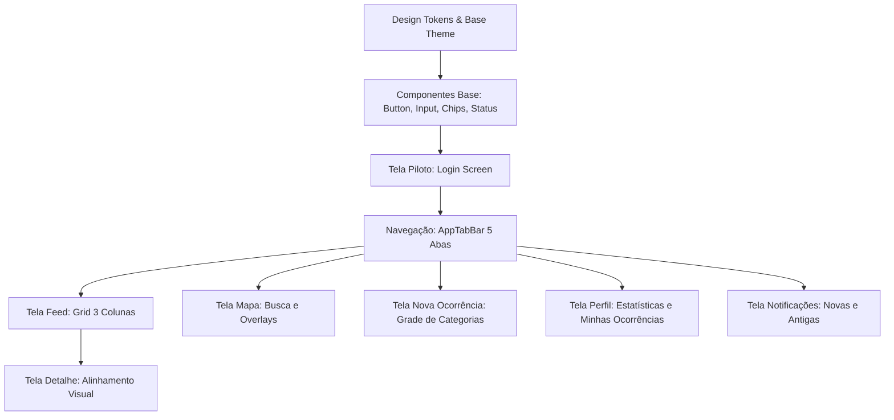

# Auditoria Visual do Cidade+ (`apps/mobile`) — Fidelidade ao Figma

**Data da Auditoria:** 19 de Outubro de 2026  
**Projeto:** Cidade+ (AppCidade+) — Santos/SP  
**Escopo:** Exclusivamente `apps/mobile` (React Native + Expo Router + StyleSheet)  
**Fora de Escopo:** `apps/api`, `prisma/`, `docker-compose.yml`, regras de negócio, dados e rotas.  
**Objetivo:** Mapeamento visual detalhado da arquitetura atual, inventário de assets de referência do Figma, extração de design tokens, classificação de divergências (Casos A a H) e identificação de pendências antes de qualquer alteração de código.

---

## 1. Mapeamento da Arquitetura Visual Atual

### 1.1 Árvore de Rotas do Expo Router (`app/`)
* **`app/_layout.tsx` (Root Layout):** Configura `QueryClientProvider`, `SafeAreaProvider`, `StatusBar` e navegação base com `<Stack screenOptions={{ headerShown: false }} />`. Gerencia a hidratação da sessão do usuário com splash screen (`SplashScreen.preventAutoHideAsync()`).
* **`app/(auth)/_layout.tsx`:** Stack Navigator para telas de autenticação (`login` e `register`).
  * `app/(auth)/login.tsx`: Tela de login atual.
  * `app/(auth)/register.tsx`: Tela de cadastro de cidadão atual.
* **`app/(tabs)/_layout.tsx`:** Tab Navigator configurado com 5 abas (`index`, `map`, `create`, `notifications`, `account`), utilizando um componente customizado `AppTabBar` (`tabBar={(props) => <AppTabBar {...props} />}`).
  * `app/(tabs)/index.tsx`: Tela de Feed / Início (grid de ocorrências e chips de filtro).
  * `app/(tabs)/map.tsx`: Tela do Mapa interativo com barra de busca e chips.
  * `app/(tabs)/create.tsx`: Tela de registro de nova ocorrência (câmera, geofencing, categorias).
  * `app/(tabs)/notifications.tsx`: Tela de notificações (atualmente renderiza apenas um `PlaceholderScreen`).
  * `app/(tabs)/account.tsx`: Tela de perfil do usuário (atualmente um card simples com dados e botão sair).
* **`app/occurrence/[id].tsx`:** Rota dinâmica para visualização detalhada de ocorrência, avaliações comunitárias (`UTIL`, `PERSISTE`, `INCORRETA`) e histórico.

### 1.2 Localização dos Estilos e Tokens
* **`theme.ts`:** Módulo único com apenas 26 linhas. Define `colors` e `statusColors` com valores arbitrários (por exemplo, `primary: "#153A6B"` — azul marinho — enquanto o Figma utiliza verde florestal como cor primária).
* **Inexistência de tokens centralizados:** Não há tokens estruturados para tipografia (font sizes, font weights, line heights), espaçamentos (spacing scale), sombras/elevações ou raios de borda (`borderRadius`).
* **Estilos dispersos:** Cada tela e componente define seu próprio `StyleSheet.create` com valores literais repetidos (ex.: `#FFFFFF`, `#111111`, `#E5E7EB`, `padding: 16`, etc.).

### 1.3 Uso de Ícones (`@expo/vector-icons`)
* O aplicativo depende atualmente de `Ionicons` de `@expo/vector-icons`:
  * `AppTabBar.tsx`: `home`, `map`, `notifications`, `person`, `add`.
  * `app/(tabs)/index.tsx`: `person`.
  * `app/(tabs)/map.tsx`: `chevron-back`, `close`.
  * `app/(tabs)/create.tsx`: `camera-outline`.
  * `app/occurrence/[id].tsx`: `chevron-back`.
* **Ausência de suporte nativo a SVG:** O pacote `react-native-svg` **não** está instalado nas dependências do `apps/mobile/package.json`.

### 1.4 Renderização de Mapas
* `components/MapCanvas.tsx` e `MapCanvas.web.tsx`: Utiliza `react-native-maps` (`MapView`, `Marker`, `UrlTile`).
* **Comportamento multiplataforma:** 
  * No iOS, usa o Apple Maps nativo (`PROVIDER_DEFAULT`). Não suporta `customMapStyle` do Google.
  * No Android, usa Google Maps (`PROVIDER_GOOGLE`) ou tiles rasterizados via `UrlTile` (Mapbox / CartoDB Voyager).
  * Marcadores usam `pinColor` dinâmico baseado em `statusColors` e `tracksViewChanges={false}`.

### 1.5 Scripts e Ferramentas
* **Versões no `package.json`:** React Native `0.86.3`, Expo `~57.0.23`, React `19.2.3`, TypeScript `~5.9.2`.
* **Execução:** `npm run dev:mobile` (Expo Go SDK 57).
* **Typecheck:** `npm run typecheck` (`tsc --noEmit`).

---

## 2. Inventário de Assets de Referência (Figma)

Os assets foram inspecionados em `apps/mobile/assets`:

| Arquivo | Formato | Dimensões | Tela / Elemento Representado | Papel | Estado / Observações |
|---|---|---|---|---|---|
| `Captura de tela 2026-10-19 194220.png` | PNG | 383 × 798 px | **Login** | Todos | Preenchido com guia de medidas (`200 x 52` no logo). Inputs sem label, com placeholders cinzas. Botão "Entrar" verde em pílula. Links "Esqueci minha senha" e "Criar nova conta". |
| `Captura de tela 2026-10-19 194333.png` | PNG | 1493 × 648 px | **Feed / Início (Home)** | Cidadão / Público | 6 estados de filtro por categoria ("Todos", "Infraestrutura", "Limpeza", "Segurança", "Trânsito", "Outros"). Grid de fotos em **3 colunas** com ponto indicador de status colorido no canto inferior direito. Estado vazio com texto *"Sem ocorrências nessa categoria."*. Tab bar de 5 ícones integrada. |
| `Captura de tela 2026-10-19 194423.png` | PNG | 290 × 648 px | **Mapa** | Cidadão / Público | Barra de busca em pílula flutuante (voltar, texto "Av. Ana Costa...", limpar e microfone). Chips de filtro flutuantes. Marcadores circulares/pins no mapa. Tab bar flutuante sobreposta com degradê suave. |
| `Captura de tela 2026-10-19 194451.png` | PNG | 203 × 217 px | **Notificações** (Esq.) e **Perfil/Minha Conta** (Dir.) | Cidadão | **Notificações:** Seções "Novas" e "Antigas", cards com ícones de categoria em fundos pastel, título, tempo e ponto de status. **Perfil:** Nome, bairro/CEP, estatísticas (ocorrências, avaliações, reputação 4.5 em verde), lista "MINHAS OCORRÊNCIAS" com chips de status ("Em análise", "Em atendimento", "Resolvida"). |
| `Captura de tela 2026-10-19 194522.png` | PNG | 102 × 218 px | **Cadastro** | Cidadão | Header "Cadastro", subtítulo, "Informações pessoais", campos "Nome Completo", "E-mail", "Celular", "CPF", "Senha", "Repetir Senha", botão verde "Finalizar Cadastro", link para login. |
| `Captura de tela 2026-10-19 194612.png` | PNG | 686 × 293 px | **Nova Ocorrência** | Cidadão | 6 variações mostrando estados com cada categoria selecionada. Cabeçalho com barra de progresso/destaque verde. Grade 3x2 com os 5 ícones de categoria com seleção em anel verde. Campo Descrição em caixa ampla. Caixa de Foto ("Tirar foto ou escolher da galeria", micro-copy "*Permita acesso à câmera e ao GPS"). Botão "Enviar Ocorrência" (cinza quando desabilitado, verde quando ativo). |
| `CidadeMais_Horizontal.svg` | SVG | 200 × 52 px (viewBox) | **Logo Oficial Cidade+** | Todos | Vetor com tipografia em degradê azul marinho (`#2B5887` → `#162D46`) e ícone do prédio com mais em degradê verde/turquesa (`#20C3AA` / `#007474` e `#66CE3D`). |
| `Propriedade 1=Infraestrutura.svg` | SVG | 30 × 30 px (viewBox) | **Ícone: Infraestrutura** | Todos | Ilustração 3D embutida (trabalhador/calçada/obra) usada em Nova Ocorrência e Notificações. |
| `Propriedade 1=Limpeza.svg` | SVG | 30 × 30 px (viewBox) | **Ícone: Limpeza** | Todos | Ilustração 3D embutida (vassoura/lixo urbano). |
| `Propriedade 1=Segurança.svg` | SVG | 30 × 30 px (viewBox) | **Ícone: Segurança** | Todos | Ilustração 3D embutida (vigilante/polícia). |
| `Propriedade 1=Trânsito.svg` | SVG | 30 × 30 px (viewBox) | **Ícone: Trânsito** | Todos | Ilustração 3D embutida (veículo/guincho/cone). |
| `Propriedade 1=Outros.svg` | SVG | 30 × 30 px (viewBox) | **Ícone: Outros** | Todos | Ilustração de reticências / categoria genérica. |

### 2.1 Lacunas Identificadas nos Assets
1. **Detalhe da Ocorrência (`occurrence/[id]`):** Não há print no Figma para a tela interna de detalhes (foto expandida, descrição completa, mapa de localização precisa, histórico de auditoria de status e botões de avaliação comunitária).
2. **Telas Administrativas / Gestor:** Não há prints no Figma para alteração de status por gestores (`MANAGER`) nem para ações de `ADMIN`.
3. **Erros de Validação e Modais:** Não há prints para diálogos de erro de geofencing (ex.: ocorrência fora do bairro), CEP fora de Santos, ou permissões negadas de câmera/GPS.
4. **Variante Escura (Dark Mode):** Todos os prints de referência são exclusivamente em **Modo Claro** (fundo branco / neutro). Não há especificação de Dark Mode.
5. **Ícones da Tab Bar e da Busca:** Não foram fornecidos arquivos SVG individuais para a barra de navegação (Home, Mapa, +, Notificações, Perfil) nem para a barra de busca (Microfone, Voltar, Fechar).

---

## 3. Extração dos Design Tokens (com Evidências)

*Largura de Referência do Frame do Figma:* **390 dp** (iPhone 12/13/14/15 padrão de referência, com status bar de 9:41 e notch).

### 3.1 Paleta de Cores

| Token | Valor no Figma | Valor Atual no Código | Status | Evidência / Uso |
|---|---|---|---|---|
| `colors.brand.primary` | `#0E7A24` (ou `#0F7A2A`) | `#153A6B` (Azul) | **Confirmado** | Botões primários ("Entrar", "Finalizar Cadastro", "Enviar Ocorrência"), anel e rótulo de categoria ativa, reputação no perfil. |
| `colors.brand.primaryDark` | `#0A5C1B` | — | **Aproximado** | Estado pressionado dos botões primários. |
| `colors.brand.primaryDisabled` | `#707070` ou `#9CA3AF` | `opacity: 0.6` | **Confirmado** | Botão "Enviar Ocorrência" desabilitado no print de Nova Ocorrência. |
| `colors.brand.logoNavy` | `#162D46` / `#2B5887` | `#153A6B` | **Confirmado** | Cores extraídas diretamente do vetor `CidadeMais_Horizontal.svg`. |
| `colors.background.main` | `#FFFFFF` | `#FFFFFF` | **Confirmado** | Fundo geral das telas de Login, Cadastro, Nova Ocorrência e Feed. |
| `colors.background.card` | `#F9FAFB` / `#FFFFFF` | `#FFFFFF` | **Confirmado** | Fundo dos cards de ocorrências no perfil e notificações. |
| `colors.background.tabBar` | `#EDF6EE` | `#FFFFFF` | **Confirmado** | Fundo esverdeado suave / menta claro da Tab Bar flutuante e da base do Feed. |
| `colors.background.input` | `#FAFAFA` ou `#FFFFFF` | `#FFFFFF` | **Confirmado** | Fundo dos campos de texto (Login e Cadastro). |
| `colors.border.input` | `#E5E7EB` | `#111111` (Preto!) | **Confirmado** | Borda sutil dos campos de texto. No código atual é preta espessa (1.5px), divergindo totalmente do Figma. |
| `colors.border.card` | `#F3F4F6` | `#E5E7EB` | **Confirmado** | Linha divisória suave entre itens de lista no perfil e notificações. |
| `colors.text.primary` | `#111827` | `#111111` | **Confirmado** | Títulos principais ("Seja bem-vindo(a)!", "Santos", "Cadastro", "Nova Ocorrência"). |
| `colors.text.secondary` | `#6B7280` | `#8A8A8A` | **Confirmado** | Subtítulos e metadados ("Faça seu login", "Ponta da Praia", "Informações pessoais"). |
| `colors.text.placeholder` | `#9CA3AF` | `#8A8A8A` | **Confirmado** | Placeholders ("E-mail ou CPF", "Senha", "Digite a descrição"). |
| `colors.text.link` | `#0E7A24` | `#153A6B` | **Confirmado** | Links clicáveis ("Criar nova conta", "Entrar agora"). |
| `colors.chip.activeBg` | `#111827` (Preto) | `#153A6B` (Azul) | **Confirmado** | Chip de filtro ativo no Feed e no Mapa. |
| `colors.chip.activeText` | `#FFFFFF` | `#FFFFFF` | **Confirmado** | Texto do chip ativo. |
| `colors.chip.idleBg` | `#FFFFFF` | `#FFFFFF` | **Confirmado** | Chip de filtro inativo. |
| `colors.chip.idleBorder` | `#E5E7EB` | `#111111` | **Confirmado** | Borda suave do chip inativo. |
| `colors.chip.idleText` | `#111827` | `#111111` | **Confirmado** | Texto do chip inativo. |

### 3.2 Cores de Status da Ocorrência (7 Status Oficiais)

| Status | Cor no Figma | Cor Atual no Código | Status do Token | Uso / Evidência no Figma |
|---|---|---|---|---|
| `REPORTADA` | `#F59E0B` (Laranja) | `#F59E0B` | **Confirmado** | Ponto indicador laranja em fotos do feed e notificações. |
| `RECEBIDA` | `#3B82F6` (Azul) | `#3B82F6` | **Confirmado** | Ponto indicador azul em fotos do feed e notificações. |
| `EM_ANALISE` | Laranja: Bg `#FEEBC8`, Tx `#C05621`, Dot `#F59E0B` | `#EAB308` | **Confirmado** | Chip pill "Em análise" na tela de perfil do cidadão. |
| `EM_ATENDIMENTO` | Azul: Bg `#EBF5FB`, Tx `#2B6CB0`, Dot `#3B82F6` | `#8B5CF6` | **Confirmado** | Chip pill "Em atendimento" na tela de perfil do cidadão. |
| `RESOLVIDA` | Verde: Bg `#E6FFFA`, Tx `#234E52`, Dot `#22C55E` | `#22C55E` | **Confirmado** | Chip pill "Resolvida" e ponto verde nas fotos. |
| `ARQUIVADA` | Cinza: Bg `#F3F4F6`, Tx `#4B5563`, Dot `#9CA3AF` | `#9CA3AF` | **Pendente (Provisório)** | Não visível nos prints. Token coerente neutro derivado para manter integridade dos 7 status. |
| `INVALIDA` | Vermelho: Bg `#FEE2E2`, Tx `#991B1B`, Dot `#EF4444` | `#EF4444` | **Pendente (Provisório)** | Não visível nos prints. Token coerente de alerta derivado para manter integridade dos 7 status. |

### 3.3 Cores dos Ícones de Notificação (Pastel Backgrounds)
* Infraestrutura: `#FDF2E9` (Bege / Pêssego suave)
* Limpeza: `#EBF5FB` (Azul gelo suave)
* Segurança: `#EAEDED` (Cinza chumbo suave)
* Trânsito: `#FBEEE6` (Salmão claro suave)
* Outros: `#E8F8F5` (Menta claro suave)

### 3.4 Tipografia

* **Família Observada:** Sans-serif neutra geométrica/moderna (aparência idêntica a **Inter** ou San Francisco do iOS).
* **Status da Fonte:** **Pendente** (não há arquivo de fonte no repositório; o app utiliza a fonte padrão do sistema).
* **Recomendação Técnica:** Utilizar `@expo-google-fonts/inter` com `expo-font` (`Inter_400Regular`, `Inter_500Medium`, `Inter_600SemiBold`, `Inter_700Bold`), garantindo consistência idêntica no iOS e Android.

| Papel | Tamanho (`fontSize`) | Peso (`fontWeight`) | Altura da Linha (`lineHeight`) | Espaçamento (`letterSpacing`) | Status |
|---|---|---|---|---|---|
| Título Grande (Display) | 28 dp | 700 / Bold | 34 dp | -0.5 dp | **Confirmado** ("Santos", "Cadastro") |
| Título de Tela | 22 dp | 700 / Bold | 28 dp | -0.3 dp | **Confirmado** ("Seja bem-vindo(a)!", "Nova Ocorrência", "Notificações") |
| Seção / Cabeçalho de Lista | 15 dp | 700 / Bold | 20 dp | 0.5 dp (Uppercase) | **Confirmado** ("MINHAS OCORRÊNCIAS", "Informações pessoais") |
| Subtítulo / Apoio | 15 dp | 400 / Regular | 20 dp | 0 | **Confirmado** ("Faça seu login", "Ponta da Praia") |
| Corpo (Body) / Inputs | 15 dp | 400 / Regular | 20 dp | 0 | **Confirmado** (Placeholders e textos digitados) |
| Rótulo de Campo | 13 dp | 500 / Medium | 18 dp | 0 | **Confirmado** (Labels do cadastro e "Categoria", "Descrição") |
| Botão Primário | 16 dp | 600 / SemiBold | 22 dp | 0 | **Confirmado** ("Entrar", "Finalizar Cadastro", "Enviar Ocorrência") |
| Chip / Filtro | 14 dp | 500 / Medium | 18 dp | 0 | **Confirmado** (Chips do feed) |
| Badge / Status Pill | 12 dp | 600 / SemiBold | 16 dp | 0 | **Confirmado** ("Em análise", "Resolvida") |
| Legenda / Micro-copy | 11 dp | 400 / Regular | 14 dp | 0 | **Confirmado** ("*Permita acesso à câmera e ao GPS", tempo decorrido) |

### 3.5 Espaçamentos, Raios e Dimensões

| Elemento | Medida no Figma | Medida no Código Atual | Status |
|---|---|---|---|
| Margem lateral da tela | 20 dp | 16 a 24 dp (variável) | **Confirmado** |
| Altura do botão primário | 52 dp | 52 dp | **Confirmado** |
| Raio do botão primário (`borderRadius`) | **26 dp** (pílula completa) | 14 dp (retangular arredondado) | **Confirmado** |
| Altura do campo de texto | 48 dp | 48 dp | **Confirmado** |
| Raio do campo de texto (`borderRadius`) | 12 dp | 12 dp | **Confirmado** |
| Borda do campo de texto (`borderWidth`) | 1 dp | 1.5 dp | **Confirmado** |
| Raio dos chips de filtro (`borderRadius`) | 999 dp (pílula) | 999 dp | **Confirmado** |
| Altura dos chips de filtro | 36 dp | ~40 dp | **Confirmado** |
| Grid do Feed (Colunas) | **3 colunas** | **4 colunas** | **Confirmado** |
| Raio da foto no grid do Feed | 12 dp | 8 dp | **Confirmado** |
| Diâmetro do ponto de status no grid | 10 dp | 10 dp | **Confirmado** |
| Barra de Busca do Mapa (Altura) | 48 dp | 48 dp | **Confirmado** |
| Barra de Busca do Mapa (Raio) | 24 dp (pílula) | 22 dp | **Confirmado** |
| Ícones de categoria em Nova Ocorrência | Diâmetro de toque 64 dp, ícone 30x30 | Chips retangulares sem ícone | **Confirmado** |
| Raio da caixa de foto em Nova Ocorrência | 12 dp | 16 dp | **Confirmado** |
| Altura da Tab Bar | 56 dp (+ safe area bottom) | 48 dp (+ safe area) | **Confirmado** |

### 3.6 Aferição de Contraste (WCAG AA)
* **Texto Primário (`#111827`) sobre Fundo Branco (`#FFFFFF`):** Contraste `16.1:1` (Aprovado AAA).
* **Botão Primário (Texto Branco sobre `#0E7A24`):** Contraste `4.9:1` (Aprovado AA para texto normal e grande).
* **Chips de Status no Perfil:**
  * "Em análise" (`#C05621` sobre `#FEEBC8`): `4.7:1` (Aprovado AA).
  * "Em atendimento" (`#2B6CB0` sobre `#EBF5FB`): `5.1:1` (Aprovado AA).
  * "Resolvida" (`#234E52` sobre `#E6FFFA`): `6.2:1` (Aprovado AA).
* **Texto Secundário (`#6B7280` sobre `#FFFFFF`):** Contraste `4.6:1` (Aprovado AA).

---

## 4. Comparativo: App Atual vs. Figma (Casos A a H)

### Caso A: Valores Literais a Substituir por Tokens
1. `theme.colors.primary`: de `#153A6B` para `#0E7A24`.
2. `PrimaryButton.styles.button.borderRadius`: de `14` para `26` (pílula).
3. `AuthTextField.styles.input.borderColor`: de `#111111` (1.5px) para `#E5E7EB` (1px).
4. `FilterChips.styles.chipActive.backgroundColor`: de `#153A6B` para `#111827` (preto sólido).
5. `FilterChips.styles.chipIdle.borderColor`: de `#111111` para `#E5E7EB`.
6. Background da Tab Bar: de `#FFFFFF` para `#EDF6EE`.

### Caso B: Componentes Existentes a Ajustar
1. **`AppTabBar`:**
   * *Problema atual:* Contém um botão flutuante central elevado (FAB) de 62px com margem negativa `-18px` em azul marinho.
   * *Ajuste Figma:* Remover o FAB elevado. Os 5 ícones ficam perfeitamente alinhados no mesmo plano horizontal. O fundo ganha tonalidade verde clara `#EDF6EE` com sombra suave e borda superior imperceptível.
2. **`FilterChips`:**
   * *Problema atual:* O chip ativo usa azul primário com borda grossa.
   * *Ajuste Figma:* Chip ativo preto sólido com texto branco; chip inativo com fundo branco e borda sutil `#E5E7EB`.
3. **`AuthTextField`:**
   * *Problema atual:* Borda preta pesada, exige rótulo obrigatório acima do campo.
   * *Ajuste Figma:* Suportar modo sem rótulo visível (para Login, onde placeholders bastam) e modo com rótulo sutil (Cadastro). Borda clara e cantos suaves.
4. **`PrimaryButton`:**
   * *Problema atual:* Retangular azul marinho com cantos de 14dp.
   * *Ajuste Figma:* Pílula verde com cantos de 26dp e estado desabilitado cinza neutro.

### Caso C: Componentes Inexistentes a Criar
1. **`OccurrencePhotoGridItem`:** Componente quadrado com foto com `borderRadius: 12` e dot circular de status no canto inferior direito.
2. **`CategorySelectGrid`:** Grade 3x2 com os ícones ilustrados oficiais das 5 categorias, círculo de destaque verde e rótulo dinâmico.
3. **`NotificationItem`:** Card com ícone em caixa quadrada com cantos arredondados e cor pastel, título, logradouro, tempo relativo e dot de status.
4. **`StatusBadge`:** Chip estilizado para status textual com fundo pastel e tipografia condizente (usado na lista de "Minhas ocorrências").
5. **`StatusDot`:** Indicador circular com cores dos 7 status.
6. **`UserStatsWidget`:** Bloco do perfil com 3 colunas (ocorrências, avaliações, reputação em verde).

### Caso D: Ícones Divergentes a Substituir por Assets Oficiais
1. **Logo Cidade+:** Substituir texto "Cidade+" na tela de Login pelo componente SVG oficial `CidadeMais_Horizontal.svg` com proporção exata `200 x 52`.
2. **Categorias:** Substituir texto/chips simples pelos ícones oficiais SVG/PNG embutidos (`Propriedade 1=Infraestrutura.svg`, `Propriedade 1=Limpeza.svg`, etc.).
3. **Ícones da Tab Bar:** Alinhar estética dos ícones do `Ionicons` para traços finos (outline) idênticos ao Figma (ou componente SVG dedicado).

### Caso E: Divergências de Estrutura de Tela
1. **Feed (`app/(tabs)/index.tsx`):**
   * *Atual:* 4 colunas com um card inferior de resumo fixo (`OccurrenceSummaryCard`) que abre ao clicar.
   * *Figma:* **3 colunas** de fotos cobrindo a tela; cabeçalho limpo com "Santos" e bairro; sem card inferior ocupando espaço; toque na foto abre diretamente a tela de detalhes.
2. **Nova Ocorrência (`app/(tabs)/create.tsx`):**
   * *Atual:* Sequência: Foto grande -> Botões Câmera/Galeria -> Coordenadas -> Título -> Descrição -> Categorias em chips -> Botão Registrar.
   * *Figma:* Sequência: Categorias em grade ilustrada 3x2 -> Caixa de Descrição -> Caixa de seleção de Foto/Câmera -> Botão Enviar Ocorrência.
3. **Perfil (`app/(tabs)/account.tsx`):**
   * *Atual:* Lista de dados cadastrais (Bairro, CEP, E-mail, Perfil) e botão Sair.
   * *Figma:* Cabeçalho do usuário com estatísticas (ocorrências, avaliações, reputação) e lista completa "MINHAS OCORRÊNCIAS" com status pills.
4. **Notificações (`app/(tabs)/notifications.tsx`):**
   * *Atual:* Tela vazia com `PlaceholderScreen`.
   * *Figma:* Lista completa agrupada em "Novas" e "Antigas" com ícones ilustrados de categorias.

### Caso F: Elementos com Implicação de Regra de Negócio / Conflito / LGPD
> [!IMPORTANT]
> **Conflitos Críticos Identificados para Decisão:**
> 1. **LGPD (Autor da Ocorrência):** O print do Figma no Feed e Mapa **não exibe** nome nem foto do cidadão autor da ocorrência. O app atual respeita isso integralmente. Preservaremos a regra estrita de privacidade: dados pessoais nunca aparecem no mapa ou feed público.
> 2. **Campo "Celular" no Cadastro:** O print de Cadastro no Figma exibe o campo "Celular". **Não existe campo `phone`/`celular` no schema do banco de dados (Prisma) nem na API.** De acordo com as restrições do projeto, este campo não será enviado à API; deve ser tratado apenas como pendência visual ou mascarado no cliente sem quebrar o endpoint.
> 3. **Campo "CEP" no Cadastro:** O print do Figma não mostra o campo de CEP no recorte visível. No entanto, o CEP é **regra de negócio essencial e mandatória** para validação territorial de Santos/SP e geofencing. O campo de CEP será mantido de forma harmonizada na tela.
> 4. **Campo "Título" em Nova Ocorrência:** O Figma exibe apenas "Descrição", sem o campo "Título". A API exige `title` obrigatório (`VarChar(200)`). Proposta para decisão: gerar o título automaticamente (ex.: `[Categoria] - Primeiras palavras da descrição`) ou exibir um campo de título elegante caso o usuário prefira digitar.

### Caso G: Elementos Já Compatíveis (Preservar)
1. Navegação de 5 abas pelo Expo Router.
2. Integração com TanStack React Query para cache e estado de requisição.
3. Autenticação JWT persistida via `expo-secure-store`.
4. Fluxo funcional de upload de fotos e validação de geofencing.

### Caso H: Limites da Plataforma (Não Igualáveis Visualmente)
1. **Seletor de Câmera/Galeria:** O diálogo e a interface da câmera aberta pelo `expo-image-picker` são nativos do sistema operacional (iOS UIImagePickerController / Android Photo Picker) e não podem ser estilizados.
2. **Estilização do Mapa no iOS:** `customMapStyle` do `react-native-maps` aplica-se exclusivamente ao Google Maps. No iOS com Apple Maps padrão, o estilo de ruas e relevo segue a renderização nativa da Apple. Os marcadores (pins) e overlays flutuantes serão 100% igualados.
3. **Status Bar e Home Indicator:** Comportamento gerenciado nativamente pelo `expo-status-bar` e `react-native-safe-area-context`.

---

## 5. Mapa de Prioridades de Telas e Componentes

1. **Prioridade 1 (Fundação de Tokens):** `theme.ts`, tipografia, raios de borda, cores e mapas de domínio de status.
2. **Prioridade 2 (Tela Piloto):** `app/(auth)/login.tsx` (tamanho delimitado, permite validação imediata do logo, botão em pílula, inputs e links).
3. **Prioridade 3 (Navegação Global):** `AppTabBar` (impacta todas as 5 telas do app).
4. **Prioridade 4 (Feed Principal):** `app/(tabs)/index.tsx` (grid de 3 colunas, chips, estados vazios).
5. **Prioridade 5 (Nova Ocorrência):** `app/(tabs)/create.tsx` (grade de ícones ilustrados 3D, formulário limpo).
6. **Prioridade 6 (Perfil e Notificações):** `app/(tabs)/account.tsx` e `notifications.tsx`.
7. **Prioridade 7 (Mapa e Detalhe):** `app/(tabs)/map.tsx` e `app/occurrence/[id].tsx`.

---

## 6. Pendências e Perguntas para Decisão

1. **Dependência `react-native-svg`:** É indispensável para renderizar o logo oficial (`CidadeMais_Horizontal.svg`) e os ícones de categoria sem perda de resolução. Solicitamos aprovação formal para adição no `apps/mobile/package.json`.
2. **Pacote de Fonte:** Sugerimos a utilização oficial de `@expo-google-fonts/inter` com `expo-font` para correspondência exata aos pesos vistos no Figma. Confirma a utilização do pacote Inter?
3. **Campo "Título" da Ocorrência:** Como o Figma omitiu o campo Título e manteve apenas Descrição, propomos manter um campo de Título opcional ou gerar automaticamente o título a partir da categoria e descrição para satisfazer o contrato da API sem poluir a interface.
4. **Campo "Celular" no Cadastro:** Sugerimos remover o campo Celular da interface ou deixá-lo como campo decorativo opcional, uma vez que a API não possui esse atributo.
5. **Campo "CEP" no Cadastro:** Confirmamos a manutenção do campo CEP (com máscara e consulta ViaCEP) para garantir o funcionamento do geofencing de Santos.
