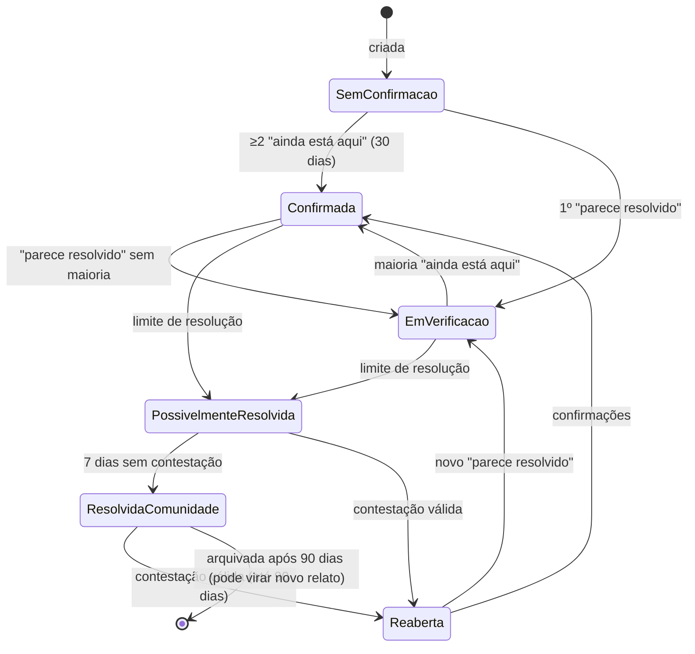
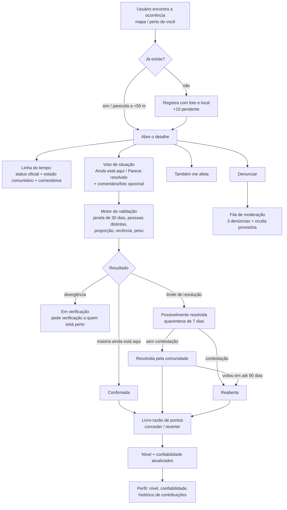

# Gamificação, reputação e validação comunitária

> Plano vivo. **Etapa atual: só auditoria, pesquisa e planejamento. Nenhum código, schema, migration ou endpoint foi alterado.**
>
> - Novos pedidos sobre o tema entram como seções datadas no fim.
> - O que não estiver confirmado fica marcado como **hipótese** ou **pendente de investigação**.
> - Relacionados: [[perfil-do-usuario]] (reputação provisória D-024), [[ocorrencias-criacao-e-mapa]], [[DECISIONS]] D-007, D-012, D-018, D-024 e D-025.

## 2026-11-15 — Estudo inicial

### 1. Contexto e objetivo

O Cidade+ não terá uma equipe visitando os locais. A proposta é que a própria comunidade:
1. registre problemas;
2. mantenha-os **atualizados** (ainda existe ou foi resolvido);
3. seja **reconhecida** por contribuições úteis e confiáveis.

**Objetivo deste estudo:**
- avaliar a viabilidade;
- propor regras de negócio, mecanismos contra abuso, um modelo de dados conceitual e as fases;
- deixar listadas as decisões que o time precisa tomar antes de implementar.

**Princípio central:** *voto comunitário é evidência colaborativa, não confirmação física*. A interface deve sempre deixar claro quando uma informação vem da comunidade e quando vem da prefeitura.

**Prazo do projeto:** entrega em 26/nov/2026 (PROJECT_CONTEXT). Isso afeta a priorização (seção 14). Para a entrega, é realista no máximo uma versão mínima da Fase 1.

---

### 2. Diagnóstico da implementação atual (conferido no código em 2026-11-15)

#### 2.1 Ocorrências

| Item | Estado atual | Onde |
|---|---|---|
| Criação | `POST /occurrences` autenticado. Em uma transação: ocorrência + mídia (foto obrigatória) + 1ª linha do histórico (`REPORTADA`). Pode ser criada em qualquer local (geofence desligada, D-018) | `apps/api/src/modules/occurrences/occurrence.service.ts` |
| Status | 7 valores: `REPORTADA → RECEBIDA → EM_ANALISE → EM_ATENDIMENTO → RESOLVIDA \| ARQUIVADA \| INVALIDA`. No app, 4 cores do Figma (`theme.ts → statusVisual`) | `prisma/schema.prisma` (enum `OccurrenceStatus`) |
| Atualização de status | **Só** `PATCH /admin/occurrences/:id/status` (MANAGER/ADMIN). Grava `OccurrenceStatusHistory` | `updateOccurrenceStatus` |
| Quem muda status na prática | **Ninguém.** Não existe painel do gestor (PROJECT_CONTEXT, seção 5). Todas as ocorrências ficam em `REPORTADA` | — |
| Histórico | `OccurrenceStatusHistory` (anterior, novo, `changedById` **obrigatório**, data). Não é exposto no DTO público nem mostrado no app | schema |
| Autor | `Occurrence.userId`. Os endpoints públicos **nunca** retornam o autor (regra de negócio 4) | `occurrence.dto.ts` |
| Bairro da ocorrência | **Não existe.** Só o usuário tem bairro, e o seed tem só 2 polígonos aproximados (Gonzaga e Ponta da Praia) | PROJECT_CONTEXT, seção 5 |
| Listagem | `GET /occurrences` devolve **todas**, sem paginação, cada uma com **todas** as linhas de avaliação (contadas em memória no DTO) | `listPublicOccurrences` |

#### 2.2 Avaliações atuais (o embrião da validação comunitária)
- Modelo `Evaluation`: `type` (`UTIL | PERSISTE | INCORRETA`), `@@unique([userId, occurrenceId])` e só `createdAt` (sem `updatedAt`).
- **O voto não pode ser alterado nem removido.** O segundo voto recebe 409 "Você já avaliou esta ocorrência".
- **Um voto só por ocorrência, somando todos os eixos:** quem marca "Útil" não pode depois dizer "Ainda existe". Isso mistura relevância com situação, o mesmo problema que o pedido aponta.
- **O autor pode votar na própria ocorrência**, porque não há checagem. A reputação (D-024) exclui esse voto, mas os contadores públicos incluem.
- Votos **não afetam o status**: só aparecem como contadores.
- **O app não sabe se o usuário já votou.**
  - O estado `voted` em `components/OccurrenceDetails.tsx` é local.
  - Ao reabrir o detalhe, os botões voltam habilitados e o toque devolve o 409.
  - O `GET /occurrences` é público e não tem contexto de usuário.
- Rótulos no app (`lib/format.ts`): "Útil", "Ainda existe" e "Incorreta".

#### 2.3 Usuários e perfil
- **Autenticação:**
  - JWT de ~15 min **sem refresh token** (D-010). Sessões caem com frequência, o que é atrito para funcionalidades de engajamento.
  - Papéis `CITIZEN`, `MANAGER` e `ADMIN`.
  - O id do usuário vem **só do token** (D-025).
- **Perfil (D-025):**
  - `GET /me/profile`: nome, foto, "membro desde", bairro (via CEP) e indicadores;
  - indicadores: ocorrências criadas, avaliações **realizadas** e reputação provisória.
  - **Não existe perfil público** de outro usuário.
- **Reputação provisória (D-024):**
  - fórmula: `5 × (UTIL + PERSISTE) ÷ avaliações recebidas`, calculada em `apps/api/src/modules/users/reputation.ts`;
  - mede a **aceitação dos relatos** do usuário, não a confiabilidade das validações que ele faz.
- **`User.reputationScore`:** existe no banco **sem uso** (D-012).
- **Pontos, níveis, conquistas e ranking:** não existem.
- **Bairro de residência:** `User.cep`, `User.neighborhood` (texto) e `User.santosNeighborhoodId` (polígono, quase sempre `null` porque há só 2 polígonos).

#### 2.4 Backend e infraestrutura
- Fastify 5 + Zod (schemas `strict`), Prisma 6, PostgreSQL 16 + PostGIS.
- **Sem rate limiting**: não há `@fastify/rate-limit` nem equivalente.
- **Sem jobs agendados.** Regras dependentes de tempo (expiração de votos, prazos) precisariam de cálculo na leitura ou de um agendador novo.
- **Sem moderação:** não há denúncia, ocultação de conteúdo nem painel de gestor/admin.
- **Sem notificações:** a aba Notificações é placeholder e não há push. Os ciclos de feedback ("sua ocorrência foi confirmada") hoje não têm canal.
- Cabe com folga no banco relacional atual: comentários, votos com histórico e um livro-razão de pontos são tabelas simples. O cálculo consistente de pontos e reputação é viável com transações e agregações (`groupBy`, como em `reputation.ts`).

#### 2.5 Frontend
- **Detalhes:** `OccurrenceDetailsModal` → `OccurrenceDetails`, usado no mapa, em "perto de você" e no perfil, e também na rota `/occurrence/[id]`.
  - Seção "Avaliação da comunidade" com os 3 botões e os contadores.
  - Esse é o lugar natural de **situação + comentários + linha do tempo**.
- **Perfil** (`app/(tabs)/account.tsx`): já tem a fileira de indicadores (Figma) e "Minhas ocorrências". É o lugar natural de **nível, confiabilidade e histórico de contribuições**.
- **Mapa e lista:** marcadores por status (D-027). Um estado comunitário ("possivelmente resolvida") precisaria de representação visual própria, sem conflitar com as 4 cores de status.

#### 2.6 Limitações que afetam a futura implementação
1. **Não existe fluxo oficial de status** (sem painel). Na prática, a validação comunitária seria a **única** fonte de atualização, o que aumenta o impacto de erros.
2. **`OccurrenceStatusHistory.changedById` é obrigatório.** Mudanças automáticas exigiriam um usuário "sistema" ou um histórico separado (recomendado: separado, seção 11).
3. **Um voto por usuário e por ocorrência, imutável.** Incompatível com "o problema voltou" e com mudar de opinião. Exige um modelo novo e a migração dos votos existentes.
4. **Sem bairro na ocorrência e só 2 polígonos aproximados.** Bônus territoriais ou ranking por bairro **não são viáveis** sem os polígonos oficiais da Prefeitura, que estão como "não iniciado".
5. **Autor oculto publicamente (regra 4).** Comentários com autor visível exigem uma decisão de privacidade (seção 16).
6. **Listagem sem paginação, contando votos em memória.** Calcular o estado comunitário por requisição pioraria o custo; será preciso guardar contadores e o estado desnormalizados.
7. **Sem rate limit, sem moderação e sem push.** São pré-requisitos de segurança e de engajamento.
8. **Localização do usuário:** existe no app (`use-user-location`, só em primeiro plano), mas é **informada pelo cliente** e pode ser falsificada. Serve como sinal, não como prova.

---

### 3. Referências externas pesquisadas

Legenda:
- **[C]** = confirmado em documentação oficial ou página de ajuda do próprio produto;
- **[S]** = fonte secundária (imprensa, wiki comunitária, fórum ou artigo);
- **[H]** = hipótese ou interpretação nossa.

#### 3.1 Waze
- **[C]** Tocar em "Not there" num relato que deixou de ser verdadeiro **reduz o tempo** em que ele fica no mapa ([Report road hazards — Waze Help](https://support.google.com/waze/answer/13739290)).
- **[C]** Na documentação para parceiros: um incidente sai do mapa no fim do seu tempo de vida ou quando vários usuários o marcam como "not there".
  - Exemplo do documento: **2 "Not There" sem nenhum "Thumbs Up" ativo** derrubam a confiança para −1.
  - Os usuários ganham níveis dirigindo e contribuindo; **quanto maior o nível, maior a confiabilidade** (escala 0–10) atribuída aos relatos.
  - Fonte: [Waze Data Feed](https://support.google.com/waze/partners/answer/10618035).
- **[S]** O "thumbs up" prolonga a vida do relato, e os relatos geram pontos.
  - Níveis: Baby → Grown-Up → Warrior → Knight → Royalty. O Royalty depende de estar no topo percentual da região.
  - Os valores de pontos variam entre fontes.
  - Fontes: [fórum Waze](https://www.waze.com/discuss/t/how-to-deal-with-bogus-reports/195664), [Wazeopedia — Rank](https://wazeopedia.waze.com/wiki/UAE/Rank), [SlashGear](https://www.slashgear.com/2235547/waze-points-explained/).
- **Aproveitar:**
  - confirmação de dois lados ("ainda está aqui" e "não está mais");
  - um limite que combina negativos **e a ausência de positivos**;
  - o peso do relato pela confiabilidade do autor.
- **Não aproveitar:**
  - expiração automática: alertas de trânsito vivem minutos, mas um buraco vive meses;
  - ranking competitivo por região (Royalty).

#### 3.2 FixMyStreet (mySociety, Reino Unido)
- **[C]** Por padrão, **4 semanas depois do relato** a plataforma envia um questionário ao autor. Ao responder, ele pode marcar o problema como resolvido.
  - Isso fica registrado como **"fixed – user"**, diferente de **"fixed – council"**, marcado pela prefeitura.
  - Fonte: [Administrator's Manual](https://fixmystreet.org/running/admin_manual/).
- **[S]** Páginas públicas mostram relatos voltando a "aberto" via questionário ("Still open, via questionnaire") e cidadãos contestando um "fixed" indevido ([exemplo Oxfordshire](https://fixmystreet.oxfordshire.gov.uk/report/2333018)).
- **[S]** O fornecedor recomenda não marcar "fixed" antes da resolução real: um fechamento indevido gera reabertura e duplicação ([SocietyWorks](https://www.societyworks.org/2022/07/20/how-to-increase-transparency-with-fixmystreets-report-statuses/)).
- **Aproveitar (alta prioridade):**
  - **separar "resolvido pela comunidade" de "resolvido pela prefeitura"**;
  - **perguntar ativamente ao autor depois de um prazo**, o que resolve locais pouco movimentados;
  - permitir reabrir.
- **Não aproveitar:** integração com o sistema da prefeitura. Fora do escopo atual.

#### 3.3 SeeClickFix (CivicPlus, EUA)
- **[C]** Qualquer pessoa pode **fechar** um problema, desde que ele ainda não tenha sido reconhecido ("Acknowledged") pela prefeitura e **com um comentário explicando o motivo**.
  - Problemas fechados podem ser **reabertos com comentário**.
  - São **arquivados 7 dias depois do fechamento** e deixam de mudar.
  - Fonte: [Resident FAQ](https://www.civicplus.help/seeclickfix/docs/resident-frequently-asked-questions).
- **[C]** Os residentes podem **votar** ("vote to fix") e comentar.
- **[C]** As prefeituras podem **restringir** comentários e reaberturas por categoria, para reduzir o excesso ([Enable user restrictions](https://www.civicplus.help/seeclickfix/docs/enable-user-restrictions-on-request-categories)).
- **[S]** Há reclamações recorrentes de problemas fechados sem solução ([exemplo Hartford](https://www.seeclickfix.com/issues/157752-hartford311-closing-issues-that-are-not-fixed)).
- **Aproveitar:**
  - justificativa obrigatória para "resolvido" e "voltou";
  - janela de reabertura e depois arquivamento;
  - um "apoio" separado da situação ("vote to fix" = "isso também me afeta").
- **Lição:** fechar sem verificação destrói a confiança. Vale tanto para a prefeitura quanto para a comunidade.

#### 3.4 Colab (Brasil)
- **[S]** A plataforma se organiza em três eixos: **Fiscalize, Proponha e Avalie**. Outros usuários podem **apoiar e comentar** as publicações, e há uma pontuação somada por participação.
- **[S]** As fontes são de 2015 a 2019 ([Manual do Usuário](https://manualdousuario.net/colab-prefeitura-curitiba/), [Comunitas](https://comunitas.org.br/aplicativo-como-canal-de-comunicacao-entre-a-prefeitura-e-cidadao/), [Prefeitura de Santos](https://www.santos.sp.gov.br/?q=noticia/aplicativo-santista-que-conecta-prefeitura-e-cidadao-estara-em-projeto-do-facebook)).
- **Não confirmado:** se a pontuação ainda existe hoje.
- **[H]** A notícia da Prefeitura de Santos sugere que um app desse tipo já foi usado na cidade. Vale entender o histórico local antes de apresentar o Cidade+ como inédito.
- **Aproveitar:** "apoiar" como sinal de relevância.
- **Não aproveitar:** pontuação por participação bruta.

#### 3.5 Google Maps — Local Guides
- **[C]** Pontos por ação e 10 níveis com limites exponenciais: 0, 15, 75, 250, 500, 1.500, 5.000, 15.000, 50.000 e 100.000.
  - Ações de baixo esforço valem pouco: **1 ponto por fato verificado** e 1 por item reportado como incorreto. Adicionar um lugar vale 15.
  - **Pontos de contribuições em lugares removidos deixam de contar**, ou seja, há reversão.
  - Pontos e nível podem levar até 24 h para atualizar.
  - Fonte: [Local Guides points, levels & badging](https://support.google.com/maps/answer/6225851).
- **Aproveitar:**
  - níveis exponenciais, para progressão rápida no início e lenta depois;
  - pontos baixos para verificações rápidas;
  - reversão quando o conteúdo é invalidado;
  - atualização com atraso, que dificulta testar o sistema.
- **Não aproveitar:** pontos por volume (avaliações e fotos). Isso é conhecido por gerar conteúdo raso. **[H]**

#### 3.6 Stack Overflow
- **[C]** A reputação é **opcional para as ações básicas** e **libera privilégios** em patamares. Quem cai abaixo do patamar perde o privilégio ([What is reputation](https://stackoverflowteams.com/help/whats-reputation)).
- **[S]** Há um **limite diário** de reputação por votos (200) e uma **verificação diária de anomalias** que anula padrões de voto fora da curva ("serial voting") ([blog 2009](https://stackoverflow.blog/2009/03/21/more-voting-anomalies/), [Enterprise](https://support.stackenterprise.co/support/solutions/articles/22000296123-what-is-reputation-how-do-i-earn-and-lose-it-)).
- **[S]** Estudo acadêmico identificou 6 tipos de fraude de reputação, incluindo anéis de votação ([arXiv 2111.07101](https://arxiv.org/abs/2111.07101)).
- **Aproveitar:**
  - reputação = **confiança que libera capacidades**, não um troféu;
  - teto diário;
  - verificação periódica de anomalias com reversão.

#### 3.7 Community Notes (X)
- **[S]** A reputação de quem avalia **sobe quando a avaliação concorda com o resultado final** da nota e cai no caso contrário.
  - Um algoritmo de "bridging" (fatoração de matriz) privilegia notas apoiadas por avaliadores com histórico diverso.
  - Código e dados são públicos.
  - Fontes: [arXiv 2510.09585](https://arxiv.org/html/2510.09585v3), [Tom Stafford](https://tomstafford.substack.com/p/the-algorithmic-heart-of-community).
- **Aproveitar:** a **confiabilidade de quem valida medida pela concordância com o desfecho**, o núcleo da reputação proposta.
- **Não aproveitar:** a fatoração de matriz. É complexa demais para o volume do Cidade+.

#### 3.8 OpenStreetMap Notes
- **[S]** Só usuários registrados resolvem uma nota, com comentário opcional. Quem discorda pode **reativar** a nota ([LearnOSM](https://learnosm.org/en/beginner/notes/)).
- **Aproveitar:** resolver/reabrir como ações explícitas e auditáveis.

#### 3.9 O que as referências ensinam em conjunto
1. **Situação ≠ relevância.** Todos separam "ainda existe/resolvido" de "apoio".
2. **Resolução comunitária ≠ oficial.** O FixMyStreet torna isso explícito.
3. **Reabrir precisa ser fácil**, e fechar precisa de justificativa (SeeClickFix, OSM).
4. **Peso pela confiabilidade** (Waze, Community Notes), com a confiabilidade medida por **acerto**, não por volume.
5. **Pontos baixos para ações baratas, reversão e teto diário** (Local Guides, Stack Overflow).
6. **Locais pouco movimentados** são tratados **perguntando ao autor depois de um prazo** (FixMyStreet), não por expiração.

---

### 4. Análise crítica das ideias iniciais

| Ideia | Avaliação | Recomendação |
|---|---|---|
| Comentários | Úteis, mas são a parte **mais cara** (moderação, privacidade, spam) e a que mais aproxima o app de uma rede social | Fazer, **depois** da validação. Formato simples, sem respostas aninhadas e com propósito definido (seção 5) |
| "Ainda está aqui" | Essencial. Já existe como `PERSISTE`, mas imutável | Manter, como voto **de situação** mutável |
| "Já foi resolvido" | Essencial e **inexistente** hoje | Criar, sempre exibido como "**parece** resolvido" |
| "Útil" | Ambíguo: não diz se o problema existe nem se é prioridade. Hoje infla a reputação (D-024) | **Substituir** por "**Também me afeta**" (apoio, como o "vote to fix"). Serve para priorizar, não para validar |
| "Incorreta" (atual) | Mistura "não existe", "local errado", "duplicada" e "ofensiva" | Virar **denúncia com motivo** (falsa, duplicada, local errado, inapropriada). Não deve ser um voto público |
| Atualização automática de status | Viável, mas **não deve sobrescrever o status oficial** (7 status do gestor) | Criar um **estado comunitário separado** (seção 6) |
| Exemplo 12 × 2 | O resultado está certo, mas a regra simples falha: em local pouco movimentado, 3 amigos encerram qualquer coisa, e votos velhos pesam igual aos novos | Proporção + mínimo de pessoas diferentes + recência + quarentena (seção 6) |
| Pontos por criar ocorrência | Pontos imediatos incentivam ocorrências falsas e duplicadas | Pontos **só depois da confirmação** por outros usuários |
| Bônus "outro bairro" | Recompensa a mobilidade, não a utilidade. Incentiva relatos em locais desconhecidos e favorece quem circula mais. Também é **inviável hoje** (seção 2.6, item 4) | Substituir por bônus para **áreas e ocorrências pouco verificadas**, que vale para todos, inclusive os moradores (seção 7.2) |
| Comentário relevante gera pontos | "Relevante" é subjetivo; pontos por comentário geram spam | **Comentários não dão pontos.** Uma atualização **com foto** conta como verificação |
| Pontos, reputação, nível e ranking | Quatro mecânicas visíveis é complexidade demais para o MVP | Unificar (seção 7.5): **nível = função dos pontos**; **confiabilidade** separada e discreta; ranking só depois e não competitivo |
| Ranking de mais ativos | Incentiva volume e disputa (o oposto do objetivo) | Sem ranking global. Se houver, "destaques do bairro" mensais, com enquadramento colaborativo |

---

### 5. Proposta de comentários e interações

#### 5.1 Dois eixos de interação + denúncia (separados na interface)

| Eixo | Pergunta que responde | Opções | Pode mudar? | Efeito |
|---|---|---|---|---|
| **Situação** | "O problema continua lá?" | **Ainda está aqui** / **Parece resolvido** | Sim. Vale o último voto de cada pessoa; os anteriores ficam no histórico | Alimenta o estado comunitário (seção 6) |
| **Apoio** | "Isso importa para mim?" | **Também me afeta** (alternar) | Sim (desmarcar) | Priorização e contador. **Não** valida existência |
| **Denúncia** | "Tem algo errado com o conteúdo?" | Falsa · Duplicada · Local errado · Conteúdo inapropriado | Uma por pessoa por alvo | Fila de moderação; ocultação provisória (seção 9) |

#### 5.2 Comentários (Fase 2)
- **Formato:**
  - **lista plana em ordem cronológica, sem respostas aninhadas.** Respostas viram conversa paralela e moderação mais cara, e o objetivo é acompanhar a situação, não debater;
  - texto de 3 a 500 caracteres, igual à descrição.
- **Integração com a situação:**
  - ao votar "parece resolvido" ou "ainda está aqui", o app oferece "adicionar um comentário (opcional)";
  - o comentário aparece na **linha do tempo** com o selo do voto ("● Ainda está aqui · há 2 dias").
  - Assim, **o comentário serve à validação** e não vira conversa solta.
- **Linha do tempo unificada** no detalhe, da mais recente para a mais antiga. Une:
  - a criação;
  - as mudanças de status oficial;
  - as mudanças de estado comunitário;
  - os comentários (com ou sem voto).
- **Autor e data:**
  - nome de exibição (decisão pendente; seção 16, item 1), avatar, nível e "há X";
  - selo "**Autor do relato**" quando for o autor;
  - selo "**Prefeitura**" para MANAGER/ADMIN.
- **Editar:** só o próprio autor, até 15 minutos depois de publicar, com a marca "editado". Depois disso, um novo comentário.
- **Excluir:** só o próprio autor. Exclusão lógica: a linha do tempo mostra "comentário removido pelo autor", para não quebrar o contexto.
- **Fotos em comentários:**
  - **não na primeira versão**, pelo custo de moderação de imagem e LGPD (rostos e placas);
  - na Fase 2b, **1 foto opcional só em atualizações de situação** ("parece resolvido" com foto é a evidência mais forte possível), reaproveitando o upload existente (`storeOccurrenceImage`).
- **Ofensas e spam:**
  - limite de frequência (seção 9);
  - denúncia;
  - **ocultação automática provisória com 3 denúncias de pessoas diferentes**, até a revisão;
  - filtro simples de palavras (bloqueia o envio com aviso);
  - o autor do comentário é avisado quando o conteúdo é ocultado.
- **Informação falsa:** não há como verificar um comentário. Ele **não muda o estado sozinho**; só o voto de situação conta, com as regras da seção 6.

---

### 6. Proposta de validação comunitária e atualização de status

#### 6.1 Duas camadas de status (recomendação principal)
- **Status oficial** (os 7 atuais): só a prefeitura/gestor muda. Continua como está e é a fonte de verdade institucional.
- **Estado comunitário** (novo, calculado pelo sistema): o que a comunidade está observando. Aparece **ao lado** do status oficial, nunca no lugar dele.

**Motivos para não reutilizar `RESOLVIDA` automaticamente:**
1. A prefeitura perderia a distinção entre "consertei" e "a comunidade acha que sumiu" (a lição do FixMyStreet).
2. Uma reversão automática de um status oficial geraria conflito com o gestor.
3. O histórico atual exige um usuário responsável (`changedById`).

#### 6.2 Estados comunitários

| Estado | Significado mostrado ao usuário | Como entra |
|---|---|---|
| **Sem confirmação** | "Ainda não confirmada por outras pessoas" | Ao criar |
| **Confirmada** | "Confirmada por N pessoas · última há X dias" | ≥ 2 pessoas diferentes (sem contar o autor) votaram "ainda está aqui" nos últimos 30 dias |
| **Em verificação** | "Há relatos divergentes. Você passou por lá?" | Votos válidos dos dois lados sem maioria clara, ou 1º "parece resolvido" |
| **Possivelmente resolvida** | "A comunidade indica que **pode** ter sido resolvida" | Limite de resolução atingido (6.3). Começa uma **quarentena** de 7 dias |
| **Resolvida pela comunidade** | "Resolvida segundo a comunidade (não confirmado pela prefeitura)" | 7 dias de quarentena sem contestação válida |
| **Reaberta** | "Relatos indicam que o problema voltou" | Contestação válida depois de "possivelmente" ou "resolvida pela comunidade" |
| **Desatualizada** (só exibição) | "Sem atualizações há 60 dias" | Nenhum voto de situação em 60 dias. Pede verificação; **não encerra** |

**Integração com o status oficial:**
- Status oficial `RESOLVIDA`, `ARQUIVADA` ou `INVALIDA`: o estado comunitário congela e a interface mostra o oficial.
- Um "o problema voltou" sobre um `RESOLVIDA` oficial **não reabre o oficial**. Ele cria um alerta para o gestor e mostra "Relatos de que voltou" com o atalho "registrar novamente", ligado à original.
- Para o **mapa**, sem esconder nada: "Resolvida pela comunidade" pode sair do filtro padrão ("ativas"), mas continua acessível pelo filtro "resolvidas".

#### 6.3 Regra de resolução proposta (valores iniciais, para calibrar)

Considerar só **votos válidos**:
- último voto de cada pessoa;
- feito nos **últimos 30 dias**;
- de quem não é o autor (exceção em 6.4);
- de conta com mais de 24 h;
- não marcado como suspeito.

Seja **R** = soma dos pesos de "parece resolvido" e **A** = soma dos pesos de "ainda está aqui". Entra em **Possivelmente resolvida** quando **todas** valem:
1. **mínimo de pessoas diferentes:** R vem de **≥ 3 pessoas** (≥ 2 se uma delas anexou foto, a partir da Fase 2b);
2. **proporção:** `R ÷ (R + A) ≥ 0,75`;
3. **recência:** o voto "parece resolvido" mais recente é **posterior** ao último "ainda está aqui" válido, ou há pelo menos 2 "resolvido" depois dele.

**Por que esses números:**
- **3 pessoas** é o mínimo para que um único usuário com contas extras ou uma dupla não encerre nada. Com o volume esperado, um número maior travaria tudo.
- **75%** exige maioria clara e tolera 1 dissidente em cada 4.
- **30 dias** é a vida útil de uma observação de rua. Um buraco consertado há 2 meses e reaberto mostra por que votos velhos não podem pesar igual.

**Aplicando ao exemplo do pedido (12 × 2):**
- Se os 14 votos são dos últimos 30 dias e os 2 "ainda está aqui" são **antigos**: 12/14 = 0,86, com 12 pessoas → possivelmente resolvida → 7 dias de quarentena → resolvida pela comunidade.
- Se os 2 "ainda está aqui" são **os mais recentes** (de ontem), a regra de recência segura: fica "Em verificação" e o app pede verificação a quem estiver perto. Esse é o caso do conserto que não durou.
- Se os 12 "resolvido" vêm de contas criadas na mesma semana, sem histórico, e votando em sequência, os votos vão para revisão (seção 9) e não contam até lá.

**Peso por confiabilidade:**
- Na **Fase 1, todos pesam 1**: não há histórico para calibrar e o peso seria arbitrário.
- Na **Fase 3**, peso de **0,5 a 1,5** conforme a faixa de confiabilidade (seção 7.3), **limitado** para que ninguém decida sozinho.
- **O mínimo de pessoas diferentes continua contando pessoas, não peso.**

**Distância (sinal, não prova):**
- O voto de situação registra a **faixa de distância** no momento do voto (< 300 m · 300 m a 2 km · > 2 km · sem localização), **sem guardar as coordenadas do usuário** (minimização, LGPD).
- **Proposta:** votos a menos de 300 m pesam 1; os demais, 0,5. Nenhum é bloqueado, porque o GPS é informado pelo cliente e falsificável, e bloquear puniria quem passou ali de manhã e vota à noite.
- **Alternativa mais rígida:** só aceitar o voto de situação perto do local. Decisão pendente (seção 16).

#### 6.4 Casos especiais
- **O autor:**
  - "ainda está aqui" do autor **não conta** para "Confirmada", porque é autoconfirmação;
  - "parece resolvido" do autor **conta como sinal forte** (é o mais interessado e foi quem viu). Leva direto a **Possivelmente resolvida**, com quarentena de 7 dias, mas não encerra sozinho: sem contestação, fica resolvida pela comunidade.
  - Isso resolve os locais com pouco movimento, como faz o FixMyStreet.
- **Locais pouco movimentados:**
  - **pergunta ativa ao autor** depois de 30 dias sem atualização ("Sua ocorrência X ainda existe?"), por notificação in-app agora e push no futuro;
  - o selo "**Desatualizada**" aos 60 dias **em vez de encerrar**;
  - o bônus de verificação (seção 7.2) para atrair quem passar por perto.
- **Reabertura automática:**
  - **sim**, se for "Resolvida pela comunidade" e houver ≥ 2 "ainda está aqui" de pessoas diferentes depois da resolução, ou 1 com foto. Depois de 90 dias resolvida, é arquivada e o app sugere um novo relato ligado à original;
  - **não** sobre o `RESOLVIDA` oficial (6.2).
  - Toda reabertura **reverte os pontos** dados pela resolução (seção 7).
- **Mudança de voto:** permitida, com intervalo mínimo de 24 h entre mudanças da mesma pessoa na mesma ocorrência, para evitar vaivém. Todas ficam no histórico.

#### 6.5 Comunicação de incerteza (obrigatório na interface)
- Sempre "**parece** resolvido", "**segundo a comunidade**" e "N pessoas indicaram", nunca "resolvido" puro.
- Ícone ou cor distintos para os estados comunitários (por exemplo, contorno tracejado), sem reutilizar o verde "Resolvido" do Figma, que fica reservado ao oficial.
- Mostrar **quantas pessoas** e **quando** foi a última confirmação.

---

### 7. Proposta de pontos, reputação, níveis e ranking

#### 7.1 Conceitos (e o que é visível)

| Mecânica | O que mede | Visível? | Muda como |
|---|---|---|---|
| **Pontos** | Contribuições **validadas** | Sim, no perfil | Livro-razão de eventos: pendente → concedido → (revertido) |
| **Nível** | Progressão = função dos pontos | Sim, no perfil e ao lado do nome nos comentários | Calculado a partir dos pontos (não é guardado à parte) |
| **Confiabilidade** (substitui a reputação D-024) | Taxa de acerto: relatos confirmados e votos que concordaram com o desfecho | Só a **faixa**: "Nova", "Confiável", "Muito confiável" | Recalculada quando um desfecho é decidido |
| **Ranking** | Comparação entre pessoas | **Não no MVP** | Fase 4, se as métricas justificarem |

**Por que não somar pontos à reputação:** pontos medem **quanto** a pessoa contribuiu; a confiabilidade mede **quão certo** ela costuma estar. Quem vota muito e erra muito deve ter muitos pontos revertidos e confiabilidade baixa, e não "reputação alta por volume".

#### 7.2 Atividades e pontos (proposta, para calibrar)

Escala: **1 verificação útil ≈ 2 pontos**. Os valores refletem o esforço e o valor para a comunidade, não o número de toques.

| Atividade | Merece pontos? | Critério | Quando | Pontos (proposta) | Por quê |
|---|---|---|---|---|---|
| Criar ocorrência | Sim, **depois da validação** | ≥ 2 pessoas diferentes (sem o autor) confirmam, ou o gestor move para `RECEBIDA` ou adiante | Pendente → concedido | **10** | É a ação mais valiosa e mais cara (foto, local). A pendência evita o incentivo a relatos falsos |
| Ocorrência invalidada (`INVALIDA` ou denúncia procedente) | Penalidade | — | Na decisão | **−10** e reverte os pontos da ocorrência | Desestimula falsos sem punir erro honesto em excesso |
| Voto "ainda está aqui" | Sim, com limites | Concede quando a ocorrência é confirmada ou quando o voto se mostra consistente | Pendente → concedido | **2** | Ação barata e útil, mas só quando correta (lógica do Community Notes) |
| Voto "parece resolvido" | Sim, **depois do desfecho** | Concede quando vira "Resolvida pela comunidade" ou oficial e **não é reaberta em 30 dias** | Pendente → concedido | **3** | Encerrar errado é mais grave, então o ganho só vem depois de o resultado se sustentar |
| 1ª verificação de ocorrência sem voto há 30+ dias | Bônus | Qualquer voto de situação válido | Junto com o voto acima | **+3** | Substitui o "bônus outro bairro": premia **cobertura**, onde a informação falta |
| Atualização com foto (Fase 2b) | Sim | Voto de situação com foto, sem denúncia procedente | Junto com o voto | **+2** | É a evidência mais forte |
| Comentário | **Não** | — | — | 0 | Comentário vazio para farmar pontos é o abuso mais comum |
| "Também me afeta" | **Não** | — | — | 0 | É um sinal de prioridade, não uma contribuição verificável |
| Sua ocorrência foi resolvida (oficial ou comunidade) | Sim | Resolução não reaberta em 30 dias | No desfecho | **5** | Fecha o ciclo e dá feedback de impacto |
| Denúncia procedente | Sim, pequeno | Moderador confirma | Na decisão | **2** | Incentiva a moderação comunitária sem virar caça a denúncias |

**Limites:**
- teto de **30 pontos por dia** vindos de votos;
- pontos só para o **primeiro voto de situação de cada pessoa por ocorrência a cada 30 dias**, o que impede o vaivém;
- nada para votos na **própria** ocorrência.

**Exemplo de distribuição (1 mês, usuário engajado):**
- 3 ocorrências confirmadas = 30;
- 15 verificações corretas ≈ 34, das quais 4 com bônus de cobertura;
- 1 ocorrência resolvida = 5;
- total ≈ 69 pontos (nível 3 na tabela da seção 7.4).

#### 7.3 Confiabilidade

- **Fórmula (proposta):** `confiabilidade = (acertos + 2) ÷ (decididos + 4)`. É uma média com prior (Beta 2,2): começa em 0,5 e só se afasta com histórico, o que evita julgar alguém por 1 caso.
  - **Acerto:**
    - ocorrência própria confirmada;
    - voto de situação que concordou com o desfecho;
    - denúncia procedente.
  - **Erro:**
    - ocorrência invalidada;
    - voto contrário ao desfecho;
    - denúncia improcedente (com peso menor, para não desencorajar denúncias de boa-fé).
- **Faixas visíveis:**
  - **Nova**: < 5 decididos;
  - **Confiável**: ≥ 5 decididos e ≥ 0,6;
  - **Muito confiável**: ≥ 20 decididos e ≥ 0,8.
  - **Abaixo de 0,35** com ≥ 10 decididos, nada é mostrado publicamente: só uso interno (peso menor e revisão).
- **Usos internos (Fase 3):**
  - peso do voto de 0,5 a 1,5;
  - "Muito confiável" ganha quarentena menor (4 dias em vez de 7) nas resoluções que inicia;
  - denúncias de "Muito confiável" ocultam com 2 denúncias em vez de 3.
- **Relação com a D-024:** a fórmula provisória (0–5) seria **substituída**. Ela só olha os votos recebidos e conta "Útil" como positivo, o que esta proposta abandona. **Decisão pendente** (seção 16): manter a nota 0–5 do Figma ou trocá-la pelas faixas.

#### 7.4 Níveis e conquistas
- **Níveis exponenciais**, inspirados no Local Guides, com nomes cívicos e não competitivos (proposta):

| Nível | Nome | Pontos |
|---|---|---|
| 1 | Morador atento | 0 |
| 2 | Observador | 20 |
| 3 | Colaborador | 60 |
| 4 | Guardião do bairro | 150 |
| 5 | Referência local | 400 |
| 6 | Agente da cidade | 1.000 |

- O nível **nunca cai**, exceto por reversão de fraude.
- **Conquistas** (Fase 4): por **qualidade e impacto**, nunca por volume bruto. Exemplos:
  - "Primeira ocorrência confirmada";
  - "Ajudou a resolver 5 ocorrências";
  - "Verificou 10 ocorrências esquecidas" (o bônus de cobertura);
  - "1 ano colaborando".
  - Sem conquista do tipo "100 votos".

#### 7.5 Ranking
- **No MVP: nenhum.**
- **Fase 4, se as métricas pedirem:**
  - "**Destaques do bairro**" mensais (top 3 por pontos **validados** no mês), com zeragem mensal para que veteranos não dominem;
  - "**Você ajudou X vizinhos este mês**" para todos, enquadrando a participação como coletiva;
  - participação **opcional**: o usuário escolhe aparecer;
  - **sem ranking geral**, que favorece quem tem tempo e mobilidade e incentiva o farming.
- **Pré-requisito:** a ocorrência ter bairro (seção 2.6, item 4).

#### 7.6 Participação em outros bairros
- **Não recomendo o bônus por "bairro diferente do de residência".** Os riscos:
  - incentiva relatos em lugares desconhecidos;
  - favorece quem circula mais (renda, trabalho, carro);
  - cria desigualdade entre bairros;
  - o bairro de residência vem do CEP, que pode estar desatualizado.
- **Alternativas, melhores e independentes de onde a pessoa mora:**
  1. **Bônus de cobertura:** verificar ocorrências **esquecidas** (sem voto há 30 dias) em qualquer lugar (seção 7.2).
  2. **Pedido de verificação por proximidade** (com push, no futuro): "3 ocorrências perto de você precisam de confirmação".
  3. **Conquista territorial de qualidade** (Fase 4): "Contribuiu de forma confirmada em 5 bairros". Premia a confirmação, não o deslocamento.

---

### 8. Regras de negócio sugeridas (resumo) e exemplos

1. **Votos de situação:**
   - 1 voto vigente por pessoa por ocorrência; pode mudar, com intervalo de 24 h; histórico completo.
   - Só contam os dos últimos 30 dias, de contas com mais de 24 h.
   - O autor não confirma a própria ocorrência; o "parece resolvido" do autor vale como sinal forte.
2. **Resolução comunitária:**
   - exige ≥ 3 pessoas, ≥ 75% e recência;
   - passa por quarentena de 7 dias;
   - nunca altera o status oficial.
3. **Reabertura:** ≥ 2 pessoas, ou 1 com foto, em até 90 dias. Reverte os pontos.
4. **Apoio** ("também me afeta"): não valida e não dá pontos.
5. **Denúncia:** com motivo, uma por pessoa por alvo. 3 denúncias de pessoas diferentes ocultam provisoriamente.
6. **Pontos:** só para contribuições validadas, com teto diário e reversíveis. O livro-razão é a fonte da verdade.
7. **Confiabilidade:** acertos ÷ decididos com prior. Na interface, só a faixa.

**Exemplos práticos:**
- **Buraco na Av. Ana Costa:**
  - Maria cria (+10 pendente).
  - João e Pedro votam "ainda está aqui" → "Confirmada (2 pessoas)". Maria recebe os 10; João e Pedro, 2 cada.
  - 40 dias depois, Ana, Lucas e Rita votam "parece resolvido", com o último "ainda está aqui" de 35 dias atrás (fora da janela) → 3 pessoas, 100% → "Possivelmente resolvida".
  - Em 7 dias, ninguém contesta → "Resolvida pela comunidade".
  - 30 dias sem reabertura: Ana, Lucas e Rita recebem 3 cada; Maria, 5.
- **Conserto que não durou:**
  - No dia 10 da quarentena acima, Pedro vota "ainda está aqui" com foto → "Reaberta".
  - Os pontos pendentes de "resolvido" são cancelados, e a confiabilidade de Ana, Lucas e Rita registra 1 erro cada.
- **Local isolado (rua sem saída):**
  - Ninguém vota em 30 dias → o app pergunta à autora.
  - Ela responde "parece resolvido" → "Possivelmente resolvida" → sem contestação em 7 dias, "Resolvida pela comunidade".
- **Tentativa de manipulação:**
  - 4 contas criadas no mesmo dia votam "resolvido" em 6 ocorrências do mesmo trecho, em sequência.
  - A detecção de padrão (seção 9) marca os votos como suspeitos → não contam e os pontos ficam retidos até a revisão.

---

### 9. Estratégias contra fraudes e abusos

Custo: **B** = baixo, **M** = médio, **A** = alto.

| Risco | Prevenção proposta | Custo | Benefício | Fase |
|---|---|---|---|---|
| Ocorrências falsas para pontos | Pontos só depois da confirmação; −10 e reversão quando invalidada; foto já obrigatória | B | Alto | 3 |
| Duplicação do mesmo problema | Ao criar, mostrar "ocorrências parecidas a menos de 50 m na mesma categoria" e sugerir confirmar em vez de criar; denúncia "duplicada" funde (o gestor decide) | M | Alto | 1 (aviso) / 2 (fusão) |
| Votar várias vezes | Unique por pessoa e ocorrência (já existe); conta criada via CPF único (já existe), o que limita contas falsas | B | Alto | já existe |
| Grupos combinando votos | Mínimo de 3 pessoas + quarentena + reabertura fácil + detecção (contas novas votando juntas no mesmo trecho em minutos) com revisão | M | Alto | 1 (regras) / 3 (detecção) |
| Comentários vazios para recompensa | Comentário não dá pontos; mínimo de 3 caracteres; rate limit | B | Alto | 2 |
| Validar sem conhecer o local | Faixa de distância pesa o voto; pontos só se o voto concordar com o desfecho | M | Médio | 1 (registro) / 3 (peso) |
| Inflar a própria reputação | Autoconfirmação não conta; confiabilidade por acerto e não por volume; teto diário | B | Alto | 1 / 3 |
| Penalizar bairros pouco movimentados | Sem expiração automática; pergunta ao autor; bônus de cobertura; sem ranking geral | B | Alto | 1 / 3 |
| Pontos por ações de baixo valor | Apoio e comentário valem 0; verificação vale pouco; teto diário | B | Alto | 3 |
| Encerramento automático incorreto | Duas camadas (o oficial não é tocado); quarentena; reabertura; linguagem de incerteza; histórico auditável | B/M | Muito alto | 1 |
| Spam e flood geral | **Rate limit** na API: votos 30/h, comentários 10/h, criação 10/dia por usuário (valores a calibrar). Hoje **não existe nenhum** | B | Alto | 0 |
| Conteúdo ofensivo | Denúncia + ocultação provisória + filtro de palavras + **tela mínima de moderação** (hoje não existe nenhuma tela de gestor) | M/A | Alto | 2 |
| Fraude comprovada | Livro-razão com status "revertido"; anulação dos votos da conta; confiabilidade recalculada | M | Alto | 3 |

**Não recomendado agora:**
- **análise de dispositivo ou fingerprinting**: custo alto e questão de LGPD;
- **algoritmo tipo Community Notes**: exige escala que o app não tem;
- **validação obrigatória por GPS**: falsificável e exclui quem passou por lá antes.

---

### 10. Fluxos de funcionamento

**Experiência em cada etapa:**

| Etapa | O que o usuário vê | Onde |
|---|---|---|
| Encontrar | Marcador com o status oficial; estado comunitário como selo discreto (por exemplo, contorno tracejado em "possivelmente resolvida") | Mapa (`MapCanvas`), "perto de você" |
| Criar | Aviso "há 1 ocorrência parecida a 30 m. É a mesma?" → confirmar a existente | `create.tsx`, antes de enviar |
| Detalhe | Status oficial + "Confirmada por 4 pessoas · última há 2 dias"; botões de situação; "também me afeta (12)"; linha do tempo | `OccurrenceDetails` |
| Votar | Retorno imediato: "Obrigado! Sua verificação ajuda X pessoas"; selo "pendente" nos pontos | Detalhe + toast |
| Desfecho | Notificação: "A ocorrência que você confirmou foi resolvida. +3 pontos" | Aba Notificações (hoje placeholder) |
| Perfil | Nível + barra até o próximo; faixa de confiabilidade; "Minhas contribuições" (ocorrências + verificações, com desfecho) | `account.tsx` (fileira de indicadores do Figma) |

---

### 11. Modelagem de dados conceitual (**sem alterar o banco**)

> Proposta conceitual. Nada disto existe hoje. Nomes e tipos a confirmar na implementação.

| Entidade (nova ou alterada) | Campos principais | Observação |
|---|---|---|
| `SituationVote` (nova) | id, occurrenceId, userId, kind (`STILL_THERE \| RESOLVED`), distanceBucket (`NEAR \| MID \| FAR \| UNKNOWN`), commentId?, mediaId?, suspicious (bool), createdAt, supersededAt? | **Sem** unique (user, occurrence): guarda o histórico. O voto vigente é o último sem `supersededAt`. Índice (occurrenceId, createdAt) |
| `OccurrenceSupport` (nova) | occurrenceId, userId, createdAt; unique (userId, occurrenceId) | "Também me afeta" |
| `Occurrence` (alterada) | + communityState (enum), communityStateAt, lastSituationAt, stillThereCount, resolvedCount, supportCount, reopenCount, neighborhoodId? | Desnormalizado para o mapa e a lista não recalcularem (seção 2.6, item 6). `neighborhoodId` depende dos polígonos oficiais |
| `CommunityStateHistory` (nova) | occurrenceId, from, to, reason (snapshot dos contadores em JSON), actor (`SYSTEM \| USER \| MANAGER`), actorId?, createdAt | Auditável. Não usa `OccurrenceStatusHistory`, que exige `changedById` |
| `Comment` (nova) | id, occurrenceId, userId, body (≤ 500), situationVoteId?, createdAt, editedAt?, deletedAt?, hiddenAt?, hiddenReason? | Exclusão e ocultação lógicas |
| `ContentReport` (nova) | id, reporterId, targetType (`OCCURRENCE \| COMMENT`), targetId, reason (`FALSE \| DUPLICATE \| WRONG_LOCATION \| INAPPROPRIATE`), status (`OPEN \| UPHELD \| REJECTED`), reviewedById?, createdAt; unique (reporterId, targetType, targetId) | Fila de moderação |
| `ContributionEvent` (nova) — livro-razão | id, userId, type, points, refType, refId, status (`PENDING \| GRANTED \| REVERSED`), createdAt, decidedAt? | **Fonte da verdade dos pontos**: o saldo é a soma dos `GRANTED`. Permite recalcular e reverter. Índice (userId, status) |
| `UserTrust` (nova, materializada) | userId, decided, correct, score, tier, updatedAt | Recalculada nos desfechos; pode ser reconstruída do livro-razão |
| `Achievement`/`UserAchievement` (Fase 4) | code, name, criteria · userId, achievementCode, earnedAt | — |
| `Evaluation` (existente) | — | **Migração:** `PERSISTE` → `SituationVote(STILL_THERE)`; `UTIL` → `OccurrenceSupport`; `INCORRETA` → `ContentReport(FALSE)`. Depois, descontinuar. `User.reputationScore` (sem uso) pode ser removido ou reaproveitado |

**Decisão importante:** gravar os **eventos de contribuição desde a Fase 1**, mesmo sem mostrar os pontos. Assim, quando a Fase 3 entrar, os pontos e a confiabilidade podem ser **calculados retroativamente** a partir de dados reais.

---

### 12. Impactos esperados

| Camada | Impacto |
|---|---|
| **Banco** | 6 a 8 tabelas novas e campos desnormalizados em `occurrences` (migrations **aditivas**); migração dos dados de `evaluations`; índices por ocorrência e data. `neighborhoodId` depende de importar os polígonos oficiais |
| **Backend** | Módulo `community` (votos de situação, apoio, motor de estado), `comments`, `reports`, `contributions` (livro-razão e confiabilidade). Endpoints autenticados que devolvem o **"meu voto"**. `@fastify/rate-limit` (nova dependência, Fase 0). Cálculo do estado **na escrita** (no voto) + verificação de prazos **na leitura** ou num job diário (decisão pendente). Testes de integração para cada regra da seção 8 |
| **Mobile** | `OccurrenceDetails`: votos de situação no lugar dos 3 atuais, apoio, linha do tempo, comentários e denúncia. Mapa: selo de estado comunitário. Criação: aviso de duplicata. Perfil: nível, confiabilidade e contribuições. Notificações: deixar de ser placeholder |
| **Gestão** | **Tela mínima de moderação e status** (web ou dentro do app para MANAGER/ADMIN). Hoje não existe nenhuma, e sem ela as denúncias não têm destino |
| **Documentação** | Novas decisões: duas camadas de status, regra de resolução, livro-razão de pontos, substituição da D-024. Atualizar as regras de negócio 4 (exposição do autor) e 8 (avaliações) no PROJECT_CONTEXT |

---

### 13. Viabilidade técnica e riscos

- **Viável na stack atual.** São tabelas relacionais, transações e agregações. Nada exige tecnologia nova além do rate limit e, opcionalmente, de um agendador.
- **Maior risco técnico:** o **motor de estado** (concorrência de votos simultâneos). Mitigação: recalcular o estado numa transação com bloqueio da linha da ocorrência (`SELECT … FOR UPDATE`) e testes de integração.
- **Maior risco de produto:** **encerramentos incorretos**, que corroem a confiança. A mitigação está nas duas camadas, na quarentena, na reabertura e na linguagem de incerteza.
- **Maior risco de escopo:** a **moderação**. Comentários sem uma tela de moderação viram passivo. Por isso os comentários vêm depois.
- **Risco de prazo:** 26/nov/2026. A Fase 1 completa (incluindo a migração de `evaluations`) é de ordem de 1 a 2 semanas para uma pessoa. Estimativa **[H]**, não medida.
- **Risco de LGPD:** comentários e nível expõem a identidade (hoje oculta). Exige decisão e possivelmente atualização dos termos.

---

### 14. Priorização por fases

| Funcionalidade | Valor usuário | Valor comunidade | Complexidade | Manutenção | Risco de abuso | Depende de |
|---|---|---|---|---|---|---|
| Rate limit | Baixo | Alto | Baixa | Baixa | — (reduz) | — |
| "Meu voto" na API | Médio | Médio | Baixa | Baixa | — | — |
| Votos de situação mutáveis + histórico | Alto | Muito alto | Média | Baixa | Médio | rate limit |
| Estado comunitário + linha do tempo | Alto | Muito alto | Média | Média | Médio | votos de situação |
| Apoio ("também me afeta") | Médio | Médio | Baixa | Baixa | Baixo | — |
| Denúncia + moderação mínima | Baixo | Alto | Média | Média | — (reduz) | tela de gestor |
| Aviso de duplicata na criação | Médio | Alto | Baixa/Média | Baixa | — (reduz) | — |
| Comentários | Médio | Médio | Média | **Alta** | **Alto** | denúncia + moderação |
| Livro-razão de eventos (sem UI) | — | Alto (futuro) | Baixa | Baixa | — | votos de situação |
| Pontos + níveis na UI | Médio | Médio | Média | Média | Alto | livro-razão + desfechos |
| Confiabilidade + peso dos votos | Baixo (visível) | Alto | Média | Média | — (reduz) | histórico de desfechos |
| Notificações in-app / push | Alto | Alto | Média/Alta | Média | Baixo | — |
| Conquistas | Médio | Baixo | Baixa | Baixa | Médio | pontos |
| Destaques por bairro | Médio | Baixo | Média | Média | Alto | bairro na ocorrência |

**Fases recomendadas** (reorganizadas em relação à hipótese inicial):

**Fase 0 — Pré-requisitos** (pequena; independente)
- Rate limit na API.
- Endpoint do "meu voto" (corrige o 409 ao reabrir o detalhe).
- Decisão de privacidade sobre o autor (seção 16).
- Bloquear o voto do autor na própria ocorrência.

**Fase 1 — Validação comunitária** (o núcleo do problema "não temos equipe")
- Votos de situação mutáveis com histórico e faixa de distância.
- Estado comunitário em duas camadas + quarentena + reabertura.
- Linha do tempo no detalhe (sem comentários ainda).
- Apoio "também me afeta".
- Aviso de duplicata.
- Migração de `evaluations`.
- **Livro-razão de eventos gravando desde já** (sem pontos visíveis).
- Pergunta ao autor depois de 30 dias (in-app).

**Fase 2 — Comentários e moderação**
- Denúncia, ocultação provisória e **tela mínima de moderação/status para MANAGER/ADMIN**.
- Comentários planos ligados aos votos.
- 2b: foto em atualização de situação.

**Fase 3 — Pontos, níveis e confiabilidade**
- Pontos a partir do livro-razão (retroativo), níveis no perfil.
- Confiabilidade (substitui a D-024) e peso dos votos.
- Detecção de padrões e reversão.
- Notificações de desfecho.

**Fase 4 — Reconhecimento e território**
- Conquistas de qualidade.
- Bônus de cobertura no mapa ("precisa de verificação").
- Destaques mensais por bairro (opcional).
- Exige os polígonos oficiais de bairro.

**Pode ser feito independentemente:** Fase 0 inteira, apoio, aviso de duplicata e notificações in-app.

**Pré-requisitos rígidos:**
- comentários → moderação;
- pontos → livro-razão + desfechos;
- confiabilidade → histórico de desfechos;
- ranking/bairro → polígonos oficiais.

**Para a entrega de 26/nov:** se for incluir algo, o recorte sugerido é a Fase 0 + votos de situação + estado comunitário simplificado (sem quarentena configurável) + linha do tempo. **Decisão do time.**

---

### 15. Critérios de sucesso e métricas

| Métrica | Mede | Meta inicial **[H]** |
|---|---|---|
| % de ocorrências com ≥ 1 voto de situação de outra pessoa em 7 dias | A comunidade está validando? | ≥ 40% |
| Tempo mediano até a 1ª confirmação | Agilidade | < 3 dias |
| % de "resolvidas pela comunidade" reabertas em 30 dias | **Qualidade do encerramento** (a métrica mais importante) | < 10% |
| % de ocorrências "desatualizadas" (60 dias sem voto) | Cobertura | Caindo mês a mês |
| % de ocorrências `INVALIDA` ou com denúncia procedente | Qualidade dos relatos (deve **cair** com a gamificação; se subir, há farming) | < 5% |
| Concentração: % das contribuições feitas pelos 10% mais ativos | Saúde da comunidade (evitar dependência de poucos) | < 50% |
| Retenção de contribuidores em 30 dias | Engajamento real | Linha de base na Fase 1 |
| Comentários denunciados / total | Saúde das conversas | < 3% |
| Distribuição de contribuições por bairro | Desigualdade territorial | Monitorar |

**Regra de produto:** se as contribuições subirem **e** a qualidade cair (reabertura ou invalidação subindo), a gamificação está incentivando o comportamento errado. Nesse caso, rever os pontos antes de expandir.

---

### 16. Dúvidas e decisões pendentes (antes de implementar)

1. **Identidade pública.** Hoje o autor nunca aparece (regra de negócio 4). Para comentários e nível, mostrar o nome completo, só o primeiro nome + inicial ou um apelido? Implica LGPD e os termos de uso.
2. **Votos de situação a distância:** só pesar menos (proposta) ou exigir estar perto?
3. **Status oficial × comunitário:** o time concorda com as duas camadas? Ou, sem gestor ativo, o estado comunitário deve mover o status oficial (por exemplo, para `RESOLVIDA` com um ator "comunidade")?
4. **A reputação 0–5 do Figma (D-024):** manter a nota ou trocá-la pelas faixas de confiabilidade? O Figma precisaria de ajuste?
5. **Quem modera:** existe alguém do lado da prefeitura ou da equipe? Sem um moderador, comentários não deveriam entrar.
6. **Ocorrência resolvida no mapa:** sai do filtro padrão ou continua visível com selo?
7. **Prazos:**
   - janela de 30 dias, quarentena de 7, arquivamento em 90, desatualizada em 60;
   - validar com o time e calibrar com dados.
8. **Agendador:** cálculo de prazos na leitura (sem infraestrutura nova) ou job diário (`node-cron`, `pg_cron` ou o agendador do host)?
9. **Polígonos oficiais de bairro:** quando entram? Sem eles não há ranking ou bônus territorial.
10. **Escopo para 26/nov:** entra algo desta proposta ou fica tudo para depois da entrega?
11. **Histórico local:** a Prefeitura de Santos já usou um app do mesmo tipo (seção 3.4)? Investigar antes de apresentar.

### Restrições desta etapa (cumpridas)
- Nenhum arquivo de código, schema, migration, endpoint, dependência ou tela foi alterado.
- A única alteração no repositório é este documento em `plans/`.
- As limitações encontradas (seção 2.6) foram só documentadas. Por exemplo, o 409 ao reabrir o detalhe já votado é um defeito real de UX, a corrigir na Fase 0.
