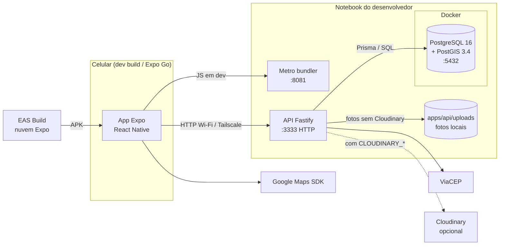
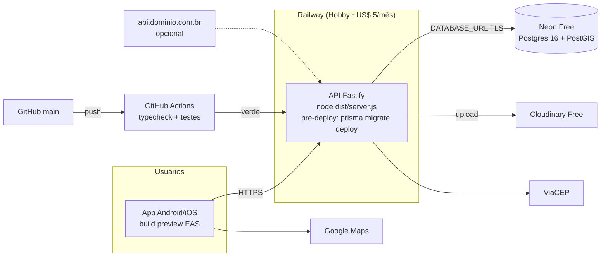
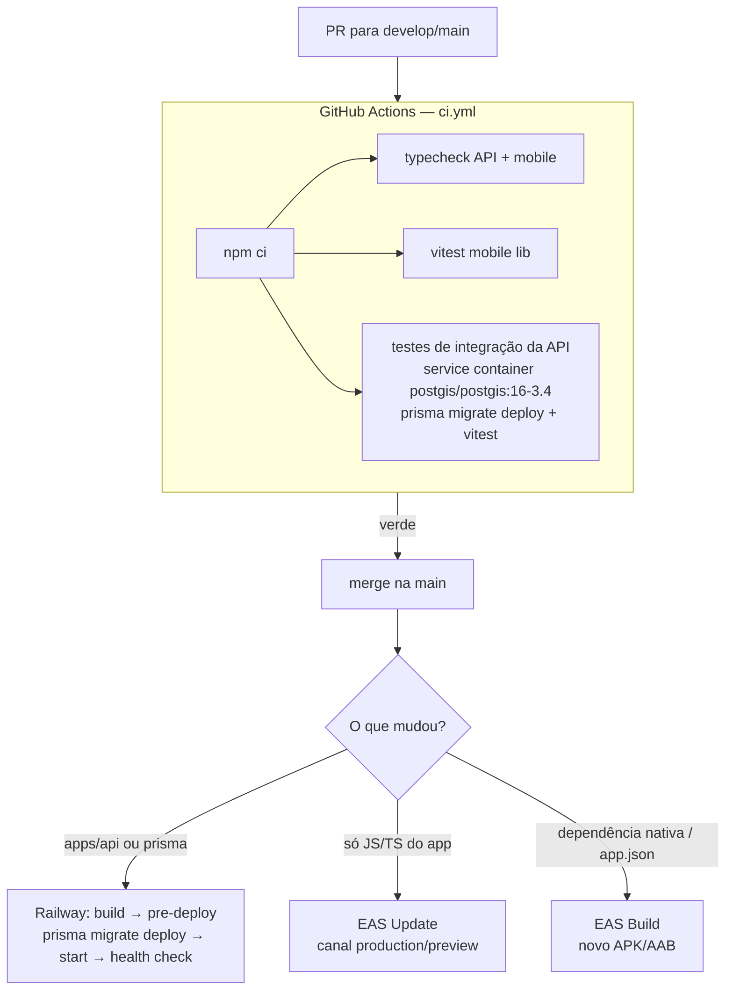

# Hospedagem, arquitetura de repositórios e CI/CD

> Plano vivo. **Etapa atual: só auditoria, pesquisa e planejamento. Nada foi implementado.** Nenhum código, Docker, workflow ou conta foi criado ou alterado.
>
> - O pedido chegou cortado no início da seção 4 ("Pesquisa e recomendação de hospedagem"). Este plano cobre os objetivos da seção 1 e a pesquisa da seção 4 até onde o texto foi.
> - Relacionados: [[ambiente-e-builds]] (dev build/EAS; a pendência "builds preview exigem API hospedada com HTTPS" é resolvida por este plano), [[AMBIENTE_DEV]], [[DECISIONS]] D-003, D-004, D-005, D-011, D-014 e D-015.

## 2026-11-15 — Auditoria e planejamento inicial

### 1. Objetivo
Terminar esta etapa sabendo:
1. onde hospedar gastando pouco;
2. como publicar o app, a API e o banco;
3. como o monorepo atual funciona e se ele atrapalha a hospedagem;
4. se vale separar os repositórios;
5. como montar o CI/CD a partir da `main`;
6. como migrar para a AWS depois sem reconstruir.

**Prazo:** apresentação em 26/nov/2026. A primeira etapa precisa ser **simples e estável**, não ótima.

---

### 2. Auditoria da arquitetura atual (conferida no código em 2026-11-15)

#### 2.1 Repositório
- **Monorepo com npm workspaces:** `apps/api` e `apps/mobile`, sem `packages/` (D-005).
  - `prisma/` (schema, migrations e seed) fica **na raiz** (D-003).
  - O `postinstall` da raiz roda `prisma generate`.
- **Git:** GitHub `caiolikk/AppCidade-`, branches `main` e `develop`. **Não existe `.github/`**, ou seja, nenhum CI.
- **Scripts da raiz:**
  - `dev:api`, `dev:mobile`, `build:preview:android`;
  - `db:up` (Docker), `db:migrate:deploy`, `db:seed`;
  - `typecheck` e `test` (só a API).

#### 2.2 Frontend (app mobile)
- **Tecnologia:** Expo SDK 54, React Native 0.81, Expo Router 6, TypeScript, TanStack Query e Zustand. É um **app nativo** (Android/iOS), não um site.
- **Builds:** pelo **EAS** (D-014). `eas.json` tem os perfis:
  - `development`: dev client, APK;
  - `preview`: APK interno;
  - `production`: auto-incremento.
  - O projeto EAS `cidadeplus/cidade-plus` já existe.
- **Consumo da API:**
  - `apps/mobile/lib/api.ts` faz `fetch` direto com JWT no header;
  - o token fica guardado no SecureStore.
- **URL da API** (`apps/mobile/lib/config.ts`): `EXPO_PUBLIC_API_URL`, depois o IP do Metro + `:3333`, depois `10.0.2.2` e por fim `127.0.0.1`.
  - **Em builds preview e produção não existe Metro.** O `EXPO_PUBLIC_API_URL` é **obrigatório** e fica **gravado no app no momento do build**: trocar a URL exige um build novo (ou um EAS Update, ver seção 6).
- **Variáveis:**
  - `apps/mobile/.env` (o Expo lê o da pasta do app, não o da raiz);
  - `GOOGLE_MAPS_ANDROID_API_KEY` lida no build por `app.config.js`, já cadastrada no EAS (development, preview e production).
  - Tudo que é `EXPO_PUBLIC_*` vai **dentro do app**: nunca colocar segredos aí.
- **Serviços externos do app:**
  - Google Maps SDK (Android);
  - Apple Maps (iOS);
  - nenhum outro: tudo passa pela API.
- **Web:** existe o alvo web (`web.bundler: metro`, `MapCanvas.web.tsx`), mas **o mapa na web é só um placeholder**. **Não há necessidade de hospedar uma versão web agora**; é opcional para demonstração (seção 4.6).
- **Sem `expo-updates`:** hoje não é possível atualizar o app pela internet (OTA). Toda mudança exige um APK novo.

#### 2.3 Backend (API)
- **Tecnologia:** Node 20+, Fastify 5, Zod, Prisma 6.14, JWT (`jsonwebtoken`), bcrypt, `@fastify/multipart`, `@fastify/static` e `@fastify/cors`. ESM (`"type": "module"`).
- **Comandos:**

| Para quê | Comando |
|---|---|
| Desenvolvimento | `npm run dev:api` (`tsx watch src/server.ts`) |
| Build | `npm run build -w @cidade-plus/api` (`tsc` → `apps/api/dist`) |
| Produção | `node dist/server.js` (script `start`) |

  - **Testado em 2026-11-15:** o build compila sem erros. O `dist/` foi apagado em seguida.
- **Configuração** (`apps/api/src/config/env.ts`, validada com Zod):
  - lê o `.env` da raiz e depois o de `apps/api`;
  - variáveis: `NODE_ENV`, `API_HOST` (padrão `0.0.0.0`), `API_PORT` (padrão 3333), `DATABASE_URL`, `JWT_SECRET` (mínimo 16), `JWT_EXPIRES_IN` (15m), `CLOUDINARY_*` (opcionais) e `OCCURRENCE_GEOFENCE_ENABLED`.
- **Porta:** 3333, HTTP puro, sem TLS (o TLS fica a cargo da plataforma ou do proxy).
- **Uploads** (`services/upload.ts`):
  - com `CLOUDINARY_*`, vão para o **Cloudinary**;
  - sem elas, vão para o **disco local** `apps/api/uploads`, servido em `/media/`;
  - a URL gravada no banco é **absoluta**, montada com o host da requisição (`x-forwarded-host`/`x-forwarded-proto`).
- **Banco:** Prisma com `DATABASE_URL`. Usa SQL cru com PostGIS no geofencing (`ST_Contains`).
- **Serviços externos:**
  - **ViaCEP** (HTTP público, no cadastro e na troca de CEP);
  - **Cloudinary** (opcional).
- **`/health`:** responde `ok` **mesmo com o banco fora do ar**. O `server.ts` sobe a API mesmo sem conectar ao Prisma.

#### 2.4 Banco de dados
- **PostgreSQL 16 + PostGIS 3.4** (imagem `postgis/postgis:16-3.4`).
- **A 1ª migration executa `CREATE EXTENSION IF NOT EXISTS postgis`.** O banco de produção **precisa suportar PostGIS**.
- **Migrations:** `npx prisma migrate deploy` (3 migrations: foundation, subcategories e user_avatar, as duas últimas aditivas).
- **Seed** (`prisma/seed.ts`), **obrigatório 1 vez em produção**:
  - categorias, subcategorias e bairros (2 polígonos aproximados);
  - usuários de staff.
  - **Atenção:** sem `SEED_ADMIN_PASSWORD` e `SEED_MANAGER_PASSWORD`, usa as senhas padrão `admin1234` e `gestor1234`, **inaceitável em produção**.
- **Persistência local:** volume Docker `cidade_plus_pgdata`.
- **Backup:** **não existe nenhum**.

#### 2.5 Docker
- `docker-compose.yml` tem **um único serviço**: `postgres`.
  - Porta `${POSTGRES_PORT:-5432}`, volume nomeado, healthcheck com `pg_isready` e variáveis `POSTGRES_*` do `.env`.
- **A API e o app não rodam em container.** Não existe `Dockerfile`.
- **Reaproveitável em produção:**
  - **só a imagem** `postgis/postgis:16-3.4`, se o banco ficar numa VPS;
  - o compose de dev expõe a porta 5432 e não tem backup nem rede interna, então **não deve ir para produção como está**.

#### 2.6 Diagrama da arquitetura atual (desenvolvimento)



**Conclusão:**
- Hoje **tudo depende do notebook ligado e acessível**.
- O que precisa ir para a internet: **API (com HTTPS)**, **banco com PostGIS** e **armazenamento de fotos**.
- O **app** é distribuído pelo EAS (APK) e **não precisa de servidor**.

#### 2.7 O que falta para rodar a API num servidor externo (só documentado; não implementado)

| # | Lacuna | Impacto | Ajuste previsto |
|---|---|---|---|
| 1 | `env.ts` lê **`API_PORT`**, mas as plataformas (Railway, Render, Heroku-like) injetam **`PORT`** | A API sobe na porta errada e o health check falha | Ler `PORT` com fallback para `API_PORT` (1 linha), **ou** configurar `API_PORT` com o valor da porta da plataforma |
| 2 | Nada roda `prisma migrate deploy` no deploy | Schema desatualizado depois de uma migration nova | Comando de "pre-deploy/release" na plataforma ou um passo do CI |
| 3 | Fotos em disco local | Na maioria das plataformas, o disco é **efêmero**: as fotos somem a cada deploy | **Cloudinary obrigatório em produção** (o código já suporta) |
| 4 | **URLs absolutas com o IP local** já gravadas no banco de dev (113 arquivos em `apps/api/uploads`) | Migrar o banco de dev leva imagens quebradas | Começar a produção com o **banco limpo** (migrations + seed), sem copiar o de dev |
| 5 | Senhas padrão do seed | Contas de admin/gestor com senha conhecida | Definir `SEED_*` fortes no ambiente de produção |
| 6 | `/health` não verifica o banco | A plataforma considera a API saudável com o banco fora | Health check com `SELECT 1` (ou rota `/health/ready`) |
| 7 | Sem rate limit | Abuso e custo (ver [[gamificacao-e-validacao-comunitaria]], Fase 0) | `@fastify/rate-limit` |
| 8 | `JWT_SECRET` | Precisa ser forte e exclusivo de produção | Gerar um segredo aleatório longo; só no painel da plataforma |
| 9 | Instalação no monorepo | `npm ci` na raiz instala **também o Expo/React Native** (pesado e lento no deploy da API) | `npm ci --workspace @cidade-plus/api --include-workspace-root` ou um Dockerfile em múltiplos estágios (seção 5) |
| 10 | Android em release bloqueia **HTTP sem TLS** (cleartext) por padrão **[conhecimento geral, a confirmar no build]** | O APK preview não fala com uma API em `http://` | A API em produção **precisa de HTTPS**. As plataformas dão isso automaticamente; numa VPS, usar Caddy ou Let's Encrypt |
| 11 | CORS `origin: true` | Aceitável para app nativo | Restringir a domínios conhecidos se houver versão web |

Nenhum desses itens exige reescrever o projeto. São ajustes de configuração ou de poucas linhas, a fazer na etapa de implementação.

---

### 3. Pesquisa de hospedagem

Legenda:
- **[C]** = documentação oficial;
- **[S]** = fonte secundária (blogs e comparadores; preços mudam);
- **[H]** = interpretação nossa.

Preços de nov/2026; **conferir na página oficial antes de contratar**.

#### 3.1 Bem-vindo.net (opção pedida)
- **[C]** Vende **hospedagem de sites** (planos Personal, Master, Gold e Business; 10 a 150 GB SSD; a partir de ~R$ 15/mês no plano anual; domínio grátis + SSL) ([planos](https://www.bem-vindo.net/planos-de-hospedagem), [hospedagem de sites](https://www.bem-vindo.net/hospedagem-de-sites)).
- **Não encontrei oferta de VPS, Node.js nem PostgreSQL/PostGIS** no site.
- **[H]** É hospedagem compartilhada voltada a sites (tipicamente PHP/MySQL). **Não serve para a API Fastify nem para o PostGIS.**
- **Uso possível:** registrar o **domínio** e hospedar uma página institucional.
- **Pendente:** perguntar ao suporte se há Node.js e PostgreSQL com extensões. Se não houver, está descartada para a API.

#### 3.2 Plataformas (PaaS) para a API

| Opção | Custo inicial | Prós | Contras |
|---|---|---|---|
| **Railway** | Hobby **US$ 5/mês**, que inclui US$ 5 de uso. Trial de US$ 5 por 30 dias e depois US$ 1/mês no Free **[S]** ([encore.dev](https://encore.dev/articles/render-vs-railway), [comparedge](https://comparedge.com/tools/railway/pricing)) | Deploy automático do GitHub; detecta monorepo (root directory e comandos); HTTPS e domínio automáticos; **template de Postgres com PostGIS** ([prisma.io](https://www.prisma.io/blog/app-hosting-platforms-with-managed-postgres-2026)) **[S]**; não dorme no Hobby | Cobrança por uso (o "US$ 5" é mínimo, não teto); sem região no Brasil **[H, a confirmar]** |
| **Render** | Web free: **dorme depois de 15 min** e leva ~1 min para acordar. Postgres free **expira em 30 dias**, com 1 GB e sem backup **[S]**. Pago: web a partir de US$ 7 e Postgres a partir de US$ 6 ([temps.sh](https://temps.sh/blog/render-pricing-2026), [whichdevtool](https://whichdevtool.com/tools/render/)) | Simples; deploy do GitHub; HTTPS | O plano free é ruim para apresentação (acordar leva ~1 min). O Postgres free some em 30 dias |
| **Fly.io** | **Sem free tier** para contas novas; trial de 2 h ou 7 dias **[S]** ([temps.sh](https://temps.sh/blog/fly-io-pricing-2026)) | Containers próximos de "infra real"; região em São Paulo **[H, a confirmar]** | Mais configuração (Dockerfile, `fly.toml`); custo por uso |
| **Koyeb** | Free retirado para contas novas em fev/2026; Pro US$ 29 **[S]** ([snapdeploy](https://snapdeploy.dev/koyeb-alternative)) | — | Caro para o estágio atual |

#### 3.3 Banco gerenciado com PostGIS

| Opção | Custo | PostGIS | Observações |
|---|---|---|---|
| **Neon** | **Free:** 100 CU-h/mês por projeto, ~0,5 a 1 GB por projeto (fontes divergem), escala a zero depois de 5 min **[C/S]** ([FAQ Neon](https://neon.com/faqs/free-plan-limits-and-quotas)) | **[C] Sim**: `CREATE EXTENSION postgis` em qualquer projeto. PostGIS 3.3.10 no PG 16 ([docs](https://neon.com/docs/extensions/postgis)) | Postgres padrão (sai com `pg_dump`); *branches* para testes; acordar do zero leva frações de segundo **[H]** |
| **Supabase** | **Free:** 500 MB; **pausa depois de 7 dias sem atividade** no banco, com reativação manual **[C/S]** ([pricing](https://supabase.com/pricing)) | Sim **[H, a confirmar na doc]** | A pausa de 7 dias é perigosa entre testes e a apresentação; Pro custa US$ 25 |
| **Railway (template PostGIS)** | Entra no uso do Hobby | Sim, via template **[S]** | Tudo num lugar só; backups e retenção **a confirmar** |
| **Render Postgres** | Free expira em 30 dias; pago a partir de US$ 6 | **[H, a confirmar]** | — |
| **AWS RDS PostgreSQL** | O Free plan novo dá **até US$ 200 em créditos** e a conta fecha depois de 6 meses **[S]**; RDS no Free plan com db.t3/t4g.micro ([AWS RDS Free](https://aws.amazon.com/rds/free/), [AWS builder](https://builder.aws.com/content/3Kkt4kNiDSUnO3n6db2weSNubzE/the-dollar0-aws-account-in-2026-free-plan-credits-guardrails)) | **[H, a confirmar]** RDS oferece PostGIS como extensão | Bom destino futuro; complexo demais para a 1ª etapa |

#### 3.4 VPS (você administra o servidor)

| Opção | Custo | Prós | Contras |
|---|---|---|---|
| **Hostinger VPS KVM 1** (1 vCPU, 4 GB, 50 GB NVMe) | **~R$ 25–30/mês em promoção** (contrato longo); renovação ~R$ 48/mês **[S]** ([horadecodar](https://horadecodar.com.br/quanto-custa-vps/), [valebyte](https://valebyte.com/en/vps/brazil/?provider=hostinger)) | **Data center no Brasil** (baixa latência); reaproveita a imagem PostGIS em Docker Compose; tudo num lugar; aprendizado próximo de EC2 | Você cuida de SO, segurança, TLS, backups e atualizações; nenhum deploy automático pronto |
| **Hetzner CX23** (2 vCPU, 4 GB) | **~€ 5,49/mês**, sem IPv4 e IVA (aumentos em 2026) **[S]** ([northflank](https://northflank.com/blog/hetzner-cloud-server-price-increases)) | Excelente custo e desempenho | Europa: latência alta para o Brasil; mesma manutenção |
| **Oracle Always Free (Ampere A1)** | Grátis, agora com **2 OCPU / 12 GB** (cortado pela metade em ago/2026) **[C/S]** ([docs Oracle](https://docs.oracle.com/en-us/iaas/Content/FreeTier/resourceref.htm), [InfoQ](https://www.infoq.com/news/2026/07/oracle-cloud-free-tier-limits/)) | Custo zero | Mudança de regra recente e sem aviso; risco de a instância ser desativada; cadastro difícil; não recomendado para algo que precisa estar no ar no dia da apresentação |

#### 3.5 Fotos
- **Cloudinary Free:** 25 créditos por mês (1 crédito = 1 GB de armazenamento, 1 GB de banda ou 1.000 transformações) **[C]** ([billing](https://cloudinary.com/documentation/billing_and_plans)).
  - Sobra para a fase de testes.
  - **O código já suporta** (D-011): basta configurar as 3 variáveis.

#### 3.6 Web (opcional)
- Não é necessária: o produto é o app, e o mapa na web é um placeholder.
- Se quiserem um link de demonstração no navegador, a **EAS Hosting** publica o `expo export -p web` **[H, a avaliar depois]**.

---

### 4. Recomendação

#### 4.1 Primeira etapa (apresentação e testes): **PaaS + banco gerenciado + Cloudinary**



**Por que esta combinação:**
1. **Custo:** ~**US$ 5/mês** (Railway Hobby). Neon e Cloudinary no free. Domínio opcional, cerca de R$ 40/ano para `.com.br` **[H, a confirmar no registro.br]**.
2. **Simplicidade:** sem servidor para administrar. HTTPS automático, deploy pelo GitHub e variáveis no painel.
3. **Estabilidade para a apresentação:** a API não dorme (diferente do Render free) e o banco não pausa por 7 dias (diferente do Supabase free).
4. **Portabilidade:** só peças padrão. O Postgres sai com `pg_dump`; a API é um processo Node configurado por variáveis; as fotos já estão fora do servidor. Isso facilita a AWS depois (seção 7).
5. **PostGIS confirmado na doc oficial do Neon.**

**Alternativa equivalente:** tudo no Railway, usando o template de Postgres com PostGIS no lugar do Neon. Um painel só, mas o banco entra no consumo pago e o backup precisa ser verificado.

**Alternativa de VPS:** **Hostinger KVM 1 (Brasil)** com Docker Compose (API + PostGIS + Caddy para HTTPS). É mais barata para tudo junto e tem a menor latência. Mas exige administrar segurança, TLS, backups e deploy. **Recomendo só se o time quiser aprender operação de servidores**; não para o prazo de 26/nov.

**Descartadas para a 1ª etapa:**
- Bem-vindo.net: sem Node nem PostGIS;
- Render free: dorme e o banco expira;
- Supabase free: pausa em 7 dias;
- Oracle free: risco de desativação;
- Koyeb e Fly.io: sem free e mais configuração;
- AWS: complexidade e créditos com prazo.

**Regiões (confirmado em 2026-11-15):**
- O Railway tem só 4 regiões: US West, **US East (Virginia)**, EU West e Asia Southeast. **Não tem Brasil** ([docs](https://docs.railway.com/reference/deployment-regions), [edge networking](https://docs.railway.com/networking/edge-networking)).
- O Neon **tem São Paulo** (`aws-sa-east-1`) ([docs](https://neon.com/docs/introduction/regions)).
- **Regra:** a API e o banco **na mesma região**. Com o Railway, isso significa o **Neon em `aws-us-east-1` (N. Virginia)** junto com o Railway US East, **não** em São Paulo.
  - Banco no Brasil + API nos EUA é o pior cenário: cada consulta do Prisma atravessaria o oceano (~120 ms cada), e telas com várias consultas em sequência somariam segundos.
- **Impacto esperado [H]:** ~120 a 150 ms a mais por requisição do celular em Santos. Aceitável para o MVP: cada tela faz 1 ou 2 requisições, e o 4G já adiciona latência.
  - Fotos (Cloudinary, CDN) e mapa (Google) não passam pela API, então não sofrem.
  - O envio da foto (até 8 MB) sente mais a banda do que a latência.
- **Região no Brasil**, se exigida (Prefeitura/LGPD): VPS no Brasil ou AWS `sa-east-1` (seção 7).

#### 4.2 Passo a passo previsto (para a etapa de implementação)
1. **Ajustes no código** (lacunas 1, 2, 5, 6 e 9 da seção 2.7):
   - ler `PORT`;
   - health check com o banco;
   - instalação/build só da API;
   - documentar as variáveis de produção em `.env.example` (só nomes).
2. **Neon:** criar o projeto na região escolhida (Postgres 16) e copiar a `DATABASE_URL` (com `sslmode=require`).
3. **Cloudinary:** criar a conta e anotar as 3 variáveis.
4. **Railway:** novo projeto a partir do repo GitHub, com:
   - raiz do repositório como diretório;
   - build: `npm ci --workspace @cidade-plus/api --include-workspace-root && npx prisma generate && npm run build -w @cidade-plus/api`;
   - pre-deploy: `npx prisma migrate deploy`;
   - start: `npm run start -w @cidade-plus/api`;
   - health check: `/health`;
   - variáveis:
     - `NODE_ENV=production`;
     - `DATABASE_URL`, `JWT_SECRET` (novo, forte);
     - `JWT_EXPIRES_IN`, `CLOUDINARY_*`;
     - `OCCURRENCE_GEOFENCE_ENABLED=false`;
     - `SEED_*` (fortes).
5. **Seed uma vez:** `npm run db:seed` apontando para o banco de produção, pelo shell do Railway ou localmente com a `DATABASE_URL` de produção, **sem gravá-la em arquivo versionado**.
6. **Domínio (opcional, recomendado):** `api.<dominio>` → Railway. Fixa a URL do app (seção 7.3).
7. **App:** no EAS, `EXPO_PUBLIC_API_URL=https://api.<dominio>` no ambiente `preview` → `npm run build:preview:android` → distribuir o APK pelo link do EAS.
8. **Validar:**
   - cadastro com CEP;
   - criar uma ocorrência com foto (precisa chegar ao Cloudinary);
   - mapa, perfil e voto;
   - reiniciar a API e conferir que as fotos continuam.
9. **Backup:** um job semanal de `pg_dump` (seção 6.4) e um teste de restauração antes da apresentação.

---

### 5. Monorepo × repositórios separados

#### 5.1 Como funciona hoje
- Um repositório e um `package-lock.json`.
- O npm instala as dependências dos dois apps.
- O Prisma fica na raiz e gera o client usado pela API (e pelos testes).
- O app mobile **não** importa código da API: só fala com ela por HTTP. Os tipos são duplicados à mão em `apps/mobile/lib/types.ts`.

#### 5.2 A estrutura atrapalha a hospedagem?
**Não, desde que os comandos sejam escopados.**
- Plataformas como o Railway aceitam o diretório raiz + comandos customizados.
- O único custo é instalar mais dependências do que o necessário (o Expo), resolvido com `--workspace … --include-workspace-root` ou com um Dockerfile em múltiplos estágios.
- O app mobile **não é hospedado** (é EAS), então não há conflito.
- **Ponto de atenção:** o deploy da API deve disparar **só** quando `apps/api/**` ou `prisma/**` mudarem. O Railway tem filtro de caminhos ("watch paths") **[H, a confirmar]**; no GitHub Actions, isso é feito com `paths:`.

#### 5.3 Comparação

| Critério | Monorepo (atual) | Repositórios separados |
|---|---|---|
| Mudança que toca a API e o app (ex.: campo novo) | **1 PR, atômico** | 2 PRs coordenados; risco de versões incompatíveis |
| Tipos compartilhados no futuro | Fácil (`packages/shared`) | Precisa publicar um pacote |
| CI | 1 pipeline com filtros por caminho | 2 pipelines mais simples |
| Deploy independente | Possível com filtros | Natural |
| Permissões por equipe | Tudo ou nada | Granulares |
| Prisma na raiz (D-003) | Funciona | Precisa mover para o repo da API |
| Histórico e documentação (`docs/`, `plans/`, o cofre) | Num lugar só | Dividido ou duplicado |
| Tamanho do time | Ideal para 4 pessoas | Mais vantajoso com equipes grandes e independentes |

**Recomendação:** **manter o monorepo.**
- Separar só se surgirem equipes independentes com ciclos de release diferentes, ou necessidade de permissões distintas.
- A separação **não melhora a hospedagem**. O que importa é o deploy ser escopado, e isso o monorepo faz.

---

### 6. CI/CD (proposta)

**Ferramentas:** **GitHub Actions** (o repo já está no GitHub) + deploy automático do **Railway** + **EAS** para o app.

**Fluxo de branches proposto:**
- trabalho em `feature/*` → PR para `develop` → CI;
- `develop` → PR para `main` → CI;
- merge na `main` → deploy de produção.
- Proteger a `main`: só via PR com CI verde.



#### 6.1 CI (em todo PR)
- `npm ci` com cache do npm.
- `npm run typecheck` (API e mobile).
- `npx vitest run apps/mobile/lib` (testes puros do app).
- **Testes de integração da API:**
  - um *service container* `postgis/postgis:16-3.4` no job;
  - `DATABASE_URL` apontando para ele;
  - `npx prisma migrate deploy`, depois `npm test`.
  - Os testes atuais exigem um Postgres (PROJECT_CONTEXT, seção 3), e é exatamente isso que o container fornece.
- Duração estimada: alguns minutos **[H]**. O GitHub Actions é gratuito para repositórios públicos e tem uma cota mensal gratuita para privados **[H, a confirmar a cota atual]**.

#### 6.2 CD da API (merge na `main`)
- **Opção A (mais simples):** o Railway faz o deploy automático da `main`, com a opção de **esperar o CI do GitHub passar** **[S/H, a confirmar o nome da opção]**.
  - `prisma migrate deploy` roda como **pre-deploy**: se a migration falhar, a versão antiga continua no ar.
- **Opção B (mais controle):** um job `deploy` no Actions, depois do CI, chama o CLI do Railway com um token guardado em *GitHub Secrets*.
- **Regra para migrations:** sempre **aditivas e compatíveis com a versão anterior** (já é a prática do projeto). Assim, se o deploy da API falhar depois da migration, a versão antiga continua funcionando com o schema novo.

#### 6.3 CD do app
- **Hoje:** cada mudança exige um build EAS novo e reinstalar o APK.
- **Proposta:**
  1. Adicionar **`expo-updates`**. Isso exige um build novo uma vez.
  2. Mudanças só de JS/TS/assets → **EAS Update** publica pela internet; o app baixa ao abrir (por canal: `preview`, `production`).
  3. Mudanças nativas (dependência nativa, `app.json` e plugins, chave do Maps) → **EAS Build** com `runtimeVersion` pela política *fingerprint*, que detecta quando um build novo é necessário.
- **Automação:**
  - **EAS Workflows** (`.eas/workflows/*.yml`, nativo do Expo); ou
  - um job do Actions com `expo/expo-github-action` + `EXPO_TOKEN` em Secrets.
  - Recomendo começar com **EAS Workflows**, que já entende fingerprint e update **[H]**.
- **Cuidado:** `EXPO_PUBLIC_API_URL` é gravado no bundle. Com um domínio próprio estável, ele não muda entre provedores (seção 7.3).

#### 6.4 Backups
- O Neon free tem restauração de histórico limitada **[a confirmar na doc]**.
- Complementar com um **workflow agendado** (cron semanal no Actions):
  - `pg_dump --format=custom` → artefato privado (ou um bucket);
  - retenção de algumas semanas;
  - `DATABASE_URL` só em Secrets.
- **Testar a restauração** (`pg_restore` num banco descartável) **antes da apresentação**. Backup nunca restaurado não conta como backup.

#### 6.5 Segredos (regra)
- Nada de `.env` no repositório (já está no `.gitignore`).
- Os segredos ficam:
  - no **painel do Railway** (API);
  - no **EAS env** (app; só valores que podem ir no app);
  - em **GitHub Secrets** (CI e backup).
- Documentar só os **nomes** em `.env.example`.

---

### 7. Caminho para a AWS (sem reconstruir)

#### 7.1 Princípios para manter desde já (portabilidade)
1. **Configuração só por variáveis de ambiente** (12-factor). Já é o caso (`env.ts` com Zod).
2. **Postgres padrão + PostGIS**, sem recursos proprietários do provedor. A migração é `pg_dump`/`pg_restore`.
3. **Arquivos fora do servidor** (Cloudinary agora; S3 depois). `services/upload.ts` já isola o armazenamento: trocar para S3 é um adaptador novo, não uma reescrita.
4. **Um `Dockerfile` para a API** (próxima etapa). O mesmo container roda em Railway, Fly, ECS/Fargate, Lightsail ou uma VPS.
5. **Domínio próprio para a API desde o início.** O app aponta para `api.<dominio>`, não para `*.up.railway.app`. Trocar de provedor vira só **mudar o DNS**, sem build novo do app.
6. **Migrations versionadas pelo Prisma** (já é o caso). O mesmo comando funciona em qualquer banco.

#### 7.2 Arquitetura-alvo na AWS (quando houver usuários e orçamento)

| Peça atual | Equivalente AWS |
|---|---|
| Railway (API) | **ECS Fargate** (container) atrás de um **Application Load Balancer**; ou **Lightsail Containers** como passo intermediário mais barato |
| Neon | **RDS for PostgreSQL** com PostGIS **[H, confirmar a versão suportada]** |
| Cloudinary | **S3 + CloudFront** (ou manter o Cloudinary, que funciona de qualquer lugar) |
| Variáveis no painel | **Secrets Manager / SSM Parameter Store** |
| Deploy do Railway | **GitHub Actions com OIDC** → push da imagem para o ECR → atualizar o serviço ECS |
| Logs do Railway | **CloudWatch** |
| Região | **sa-east-1 (São Paulo)**: menor latência para Santos |

**Passos da migração futura:**
1. Criar a infra (de preferência como código: CDK ou Terraform).
2. Restaurar o dump no RDS.
3. Subir a mesma imagem Docker.
4. Testar por um subdomínio temporário.
5. Janela curta de manutenção: dump final, depois troca do DNS de `api.<dominio>`.
6. O app continua igual.

#### 7.3 Gatilhos para migrar (para não migrar cedo demais)
- Custo do PaaS acima do equivalente na AWS **com folga**.
- Necessidade de rede privada, conformidade, região no Brasil ou integração com sistemas da Prefeitura.
- Volume que exija réplicas de leitura, filas ou escalonamento automático.
- **Antes disso, a AWS só adiciona complexidade.**

---

### 8. Riscos

| Risco | Mitigação |
|---|---|
| Fotos perdidas por disco efêmero | Cloudinary obrigatório em produção |
| Senhas padrão do seed em produção | `SEED_*` fortes; trocar as senhas depois do seed |
| Migration quebrada derruba o deploy | Pre-deploy com migrate (a versão antiga fica no ar); migrations aditivas; CI com Postgres real |
| URL da API gravada no APK | Domínio próprio; EAS Update depois do `expo-updates` |
| Cota do free do Neon ou do Cloudinary estourada | Monitorar no painel; os limites atuais sobram para testes **[H]** |
| Preços e free tiers mudando (vários mudaram em 2026) | Fornecedores padrão e trocáveis; nada proprietário |
| Latência sem região no Brasil | API e banco na mesma região; aceitável para o MVP; São Paulo na migração |
| Vazamento de segredo | Segredos só nos painéis e Secrets; `.env` fora do Git (já está) |

---

### 9. Decisões pendentes (antes de implementar)
1. **Provedor:** Railway + Neon (recomendado) ou VPS Hostinger (aprendizado de operação)?
2. **Domínio:** comprar um agora (registro.br ou o próprio Bem-vindo.net) para fixar `api.<dominio>`?
3. **Quem é o dono das contas** (Railway, Neon, Cloudinary, EAS, domínio) e quem tem acesso? Recomendado: uma conta do projeto, não uma pessoal.
4. **Fluxo de branches:** adotar `develop` → `main` com proteção da `main`?
5. **`expo-updates`:** adicionar agora (exige um build novo) ou depois da apresentação?
6. **Repositório privado ou público** (afeta a cota do GitHub Actions)?
7. **Bem-vindo.net:** confirmar com o suporte se oferece Node.js e PostgreSQL. Se não, usar só para o domínio, se for o caso.

### 10. Próximas etapas (quando autorizado)
- [ ] Ajustes de produção na API (seção 2.7: `PORT`, health com banco, instalação escopada, `.env.example`) + `Dockerfile`.
- [ ] Contas e variáveis (Neon, Cloudinary, Railway) e deploy manual da `main`.
- [ ] Seed de produção com senhas fortes; validação ponta a ponta com o APK preview.
- [ ] Workflow de CI (`.github/workflows/ci.yml`) e proteção da `main`.
- [ ] Backup agendado + teste de restauração.
- [ ] `expo-updates` + EAS Workflows (pode ficar para depois de 26/nov).

### Restrições desta etapa (cumpridas)
- Nenhum código, Docker, workflow, dependência ou conta foi criado ou alterado.
- O único comando executado além de leituras foi o **build da API** (`tsc`), para verificar se ela compila para produção. O `dist/` gerado (ignorado pelo Git) foi apagado em seguida.

## 2026-11-15 — Início da implementação: preparar o código e roteiro de configuração externa

### Pedido
Começar a hospedagem com as recomendações deste plano (Railway US East + Neon `aws-us-east-1` + Cloudinary + EAS). Entregar:
- os ajustes **no código**;
- um passo a passo do que precisa ser **configurado fora do código** (contas, painéis, variáveis, DNS, EAS).

### Auditoria complementar (2026-11-15)
- **Config as Code do Railway descontinuado:** `railway.json`/`railway.toml` **não podem ser adotados por serviços novos** e param de funcionar em **2026-12-01**. O substituto é `.railway/railway.ts` (IaC) ([docs](https://docs.railway.com/config-as-code/reference)).
  - **Decisão:** **não** versionar configuração do Railway. O build fica no **Dockerfile** (portável para Fly, ECS, VPS); pre-deploy, health check e watch paths são configurados **no painel** (roteiro abaixo).
- **Testes de integração da API:** precisam de `DATABASE_URL` e `JWT_SECRET`, das migrations e do **seed** (o teste de `/admin/health` usa o admin do seed).
  - No CI: service container PostGIS + migrate + seed (senhas padrão, aceitáveis só fora de produção).
- **`upsertStaff` do seed regrava a senha a cada execução.** Rodar o seed de novo em produção redefine as senhas de admin e gestor para os valores de `SEED_*`.
- **Neon + Prisma:** usar a string de conexão **direta** (sem `-pooler`) com `sslmode=require`.
  - A API é um processo único e longo, com pool próprio. Isso evita o `directUrl` (mudança de schema) e problemas do `migrate` com o PgBouncer.
  - Acrescentar `connect_timeout=15` por causa do "acordar" depois de escalar a zero.
- **Mobile:** sem mudança de código. Basta `EXPO_PUBLIC_API_URL` no ambiente `preview` do EAS (`lib/config.ts` já usa).
- **Visibilidade do repositório:** não verificada (sem `gh` na máquina). Por isso, o backup agendado **criptografa** o dump: artefatos de repositório público podem ser baixados por terceiros, e o dump contém CPF e e-mail.

### Estratégia (o que muda no código)
1. **`apps/api/src/config/env.ts`:**
   - porta = `PORT` (plataforma) → `API_PORT` → 3333;
   - em `NODE_ENV=production`, **exigir Cloudinary**, salvo `UPLOADS_LOCAL_IN_PRODUCTION=true` (VPS ou volume persistente). Disco efêmero perderia fotos em silêncio.
2. **`/health/ready`** (nova): `SELECT 1` no banco; 503 se falhar. É o health check do deploy. `/health` continua igual (vivacidade; teste existente).
3. **`prisma/seed.ts`:** em produção, **recusar** rodar sem `SEED_ADMIN_PASSWORD`/`SEED_MANAGER_PASSWORD` (nada de `admin1234`). Fora de produção, comportamento igual.
4. **`apps/api/Dockerfile`** (contexto = raiz do monorepo) + **`.dockerignore`** na raiz:
   - instala só o workspace da API (+ raiz/Prisma);
   - `prisma generate`, `tsc`;
   - roda como usuário sem privilégio;
   - `CMD node apps/api/dist/server.js`;
   - inclui `prisma/` para o `migrate deploy` (pre-deploy) e o seed.
5. **CI `.github/workflows/ci.yml`** (push e PR em `main`/`develop`):
   - typecheck (API + mobile);
   - testes puros do mobile;
   - testes de integração da API com `postgis/postgis:16-3.4` + migrate + seed;
   - build da imagem Docker (só verifica, não publica).
6. **Backup `.github/workflows/backup-db.yml`:**
   - semanal + manual;
   - `pg_dump` (cliente 16) → **criptografado com GPG** (senha em Secret) → artefato com retenção de 30 dias;
   - não roda se os Secrets não existirem.
7. **`.env.example`:** nomes das variáveis novas e notas de produção (só nomes).
8. **Não muda:**
   - schema/migrations;
   - endpoints existentes;
   - app mobile;
   - comportamento local (dev continua com `API_PORT`, disco local e senhas padrão do seed).

### Arquivos previstos
- `apps/api/src/config/env.ts`, `apps/api/src/app.ts`, `prisma/seed.ts`;
- `apps/api/Dockerfile`, `.dockerignore`;
- `.github/workflows/ci.yml`, `.github/workflows/backup-db.yml`;
- `.env.example`;
- teste novo de `/health/ready`.
- **Docs:** D-028 (hospedagem), PROJECT_CONTEXT (seção "Como rodar"/deploy) e este plano.

### Validação prevista
- `tsc` da API e do mobile;
- testes da API (11 + novos) com o Postgres local;
- `docker build` local da imagem, se o Docker estiver disponível, e subir o container apontando para o Postgres local, conferindo `/health/ready`;
- validação de sintaxe dos YAML.
- O deploy real depende das contas (configuração externa, feita pelo time).


### Resultado (2026-11-15) — código pronto; configuração externa pendente
**Implementado:**
- **`apps/api/src/config/env.ts`:**
  - porta = `PORT` → `API_PORT` → 3333;
  - nova `UPLOADS_LOCAL_IN_PRODUCTION`;
  - **em produção sem Cloudinary a API recusa subir**, com mensagem clara.
- **`apps/api/src/app.ts`:** `GET /health/ready` (`SELECT 1`; 200 ou **503**). `/health` não mudou.
- **`prisma/seed.ts`:** em `NODE_ENV=production`, exige `SEED_ADMIN_PASSWORD` e `SEED_MANAGER_PASSWORD` com 12+ caracteres. Fora de produção, igual a antes.
- **`apps/api/Dockerfile`** (contexto = raiz) + **`.dockerignore`:**
  - Node 20 bookworm-slim + OpenSSL;
  - instala **só** o workspace da API + raiz; nenhum pacote do Expo entra na imagem;
  - roda como usuário `node`.
- **`.github/workflows/ci.yml`:**
  - typecheck;
  - vitest do mobile;
  - PostGIS de serviço + migrate + seed + testes da API;
  - build da imagem.
- **`.github/workflows/backup-db.yml`:** `pg_dump` semanal e manual, criptografado com GPG, artefato de 30 dias. Ignorado sem Secrets.
- **`.env.example`:** bloco de produção (só nomes e regras).
- **Teste novo:** `/health/ready` em `foundation.integration.test.ts`.

**Testes executados:**

| Teste | Resultado |
|---|---|
| `npm run typecheck` (API + mobile) | OK |
| `npm test` (API, Postgres local) | **12/12** (11 + `/health/ready`) |
| `docker build -f apps/api/Dockerfile .` | OK (imagem de 843 MB) |
| Container em produção **sem Cloudinary** | Recusa subir com a mensagem esperada |
| Container com `PORT=8080` | Sobe na 8080; `/health` 200; `/health/ready` 200; `/categories` lê o banco |
| `npx prisma migrate deploy` **dentro da imagem** (o pre-deploy) | "3 migrations found… No pending migrations" |
| Seed em produção sem senhas | Recusa ("exige senhas fortes…") |
| Banco inacessível | `/health` 200 e `/health/ready` **503** (o deploy não entra no ar) |
| Usuário do processo, Expo e CLIs na imagem | `node`; 0 pacotes `expo*`; `prisma` e `tsx` presentes |
| YAML dos 2 workflows | Válidos (parse) |

**Não executado:**
- o CI no GitHub (roda no 1º push);
- o deploy real e o backup real, que dependem das contas.

**Limitações:**
- **Imagem grande (843 MB):** leva as devDependencies (TypeScript, Vitest, CLI do Prisma) para permitir o migrate e o seed no container. Otimização futura: estágio só com as dependências de produção + imagem separada para migrations.
- **CI depende do ViaCEP** (internet) nos testes de cadastro.

### Roteiro de configuração FORA do código (fazer nesta ordem)
> Segredos **nunca** em arquivo versionado nem neste documento. Guardar num gerenciador de senhas do time.

**0. Preparação**
- Decidir o **e-mail/conta do projeto** que será dono de Neon, Cloudinary, Railway e domínio.
- Gerar os segredos:
  - `JWT_SECRET`: `node -e "console.log(require('crypto').randomBytes(48).toString('base64url'))"`;
  - `SEED_ADMIN_PASSWORD` e `SEED_MANAGER_PASSWORD` (12+ caracteres);
  - `BACKUP_PASSPHRASE`.

**1. GitHub**
- Commit e push destas mudanças (`develop` → PR para `main`). O CI roda sozinho.
- Depois do 1º CI verde: *Settings → Branches → regra para `main`*:
  - exigir PR;
  - exigir os checks **"Typecheck e testes"** e **"Build da imagem da API"**.

**2. Neon (banco)**
- Criar o projeto `cidade-plus` com **Postgres 16** na região **AWS US East 1 (N. Virginia)**. **Não** escolher São Paulo, porque a API fica nos EUA.
- Copiar a connection string com o **pooling desligado** (host **sem** `-pooler`) e acrescentar `&connect_timeout=15` (o `sslmode=require` já vem).
- O PostGIS é ativado pela 1ª migration (`CREATE EXTENSION postgis`); nada a fazer no painel.

**3. Cloudinary (fotos)**
- Criar a conta (plano Free).
- Anotar o *Cloud name*, a *API key* e o *API secret*.

**4. Railway (API)**
1. Criar a conta, assinar o **Hobby** e configurar o limite de uso (*usage limit*) no workspace.
2. *New Project → Deploy from GitHub repo → `caiolikk/AppCidade-`*. O dono do repo autoriza o app do Railway no GitHub.
3. No serviço:
   - **Source:** branch `main`; *Root directory* vazio (raiz);
   - **Build:** builder **Dockerfile**, *Dockerfile path* `apps/api/Dockerfile`;
   - **Watch paths:** `apps/api/**`, `prisma/**`, `package.json`, `package-lock.json`;
   - **Deploy:**
     - *Pre-deploy command* `npx prisma migrate deploy`;
     - *Healthcheck path* `/health/ready`;
     - *Restart policy* on failure;
     - **Region US East**;
   - **Wait for CI:** ligado (só publica a `main` com o CI verde).
4. **Variables:**
   - `NODE_ENV=production`;
   - `DATABASE_URL`;
   - `JWT_SECRET`, `JWT_EXPIRES_IN=15m`;
   - `CLOUDINARY_CLOUD_NAME`, `CLOUDINARY_API_KEY`, `CLOUDINARY_API_SECRET`;
   - `OCCURRENCE_GEOFENCE_ENABLED=false`;
   - `SEED_ADMIN_PASSWORD`, `SEED_MANAGER_PASSWORD`.
   - **Não** definir `PORT`: o Railway injeta.
5. *Networking → Generate Domain*. Testar `https://<gerado>.up.railway.app/health/ready` → `{"status":"ok","database":"ok"}`.

Os nomes exatos dos campos do painel podem variar um pouco. O que importa são os valores acima.

**5. Seed (uma vez)**
- No seu terminal, com as variáveis **só na sessão**: as de ambiente têm prioridade sobre o `.env` local; não gravar em arquivo.
- PowerShell:
  ```powershell
  $env:DATABASE_URL="<string do Neon>"
  $env:NODE_ENV="production"
  $env:SEED_ADMIN_PASSWORD="<senha forte>"
  $env:SEED_MANAGER_PASSWORD="<senha forte>"
  npm run db:seed
  ```
  Depois, fechar o terminal.
- **Nunca** rodar `npm run db:migrate` (`migrate dev`) contra produção. Migrations em produção só pelo pre-deploy.
- Rodar o seed de novo **redefine** as senhas de admin e gestor.

**6. Domínio (opcional, recomendado)**
- Comprar (por exemplo, registro.br).
- Railway → *Custom Domain* `api.<dominio>` → criar o CNAME indicado no DNS → aguardar o certificado.

**7. EAS (app)**
- Criar a variável:
  ```
  eas env:create --name EXPO_PUBLIC_API_URL --value https://api.<dominio ou gerado> --environment preview --visibility plaintext
  ```
  e a mesma para `production`, quando houver.
- `npm run build:preview:android` → distribuir pelo link do EAS.
- A URL fica **gravada no APK**: trocar a URL = build novo (até existir o `expo-updates`).

**8. Teste de ponta a ponta no celular**
- cadastro com CEP de Santos;
- criar uma ocorrência com foto (precisa aparecer em *Cloudinary → Media Library*);
- mapa, detalhe e voto;
- perfil e foto do perfil;
- **redeploy** no Railway e conferir que as fotos continuam.

**9. Backup**
- GitHub *Settings → Secrets → Actions*: `PROD_DATABASE_URL` (a mesma string direta do Neon) e `BACKUP_PASSPHRASE`.
- *Actions → Backup do banco → Run workflow*.
- **Testar a restauração** num Postgres descartável (instruções no topo do `backup-db.yml`).

**10. Monitoramento (opcional)**
- UptimeRobot (ou similar) em `/health/ready`.
- Acompanhar o uso no Railway, no Neon e no Cloudinary.

**Dados antigos:** **não** migrar o banco de desenvolvimento. As fotos dele têm URLs do IP local.

### Pendências
- Executar o roteiro acima (time) e registrar aqui o resultado do 1º CI e do 1º deploy.
- Reduzir a imagem (estágio de produção).
- Rate limit (`@fastify/rate-limit`).
- Refresh token (sessão de 15 min).
- `expo-updates` + EAS Workflows.
- Painel admin web (`apps/admin`, site estático).

### Execução do roteiro (2026-11-15)
- **Neon:**
  - CLI `neon` 9.5.0 instalada e login na organização **CidadePlus** (`org-muddy-forest-87126061`, plano Free).
  - Plugin `neon-postgres` instalado no Claude Code.
  - Projeto **`cidade-plus`** (`weathered-tree-07938379`): `aws-us-east-1`, Postgres 16, banco `cidade_plus`.
  - `prisma migrate deploy` aplicou as 3 migrations; **PostGIS 3.3.10** confirmado em `pg_extension`.
  - A string de conexão não foi exibida nem gravada: é obtida na hora com `neon connection-string --project-id weathered-tree-07938379 --database-name cidade_plus` (direta, `sslmode=require`; acrescentar `connect_timeout=15`).
- **Cloudinary:** conta `pijoo54k` criada; credenciais validadas (ping 200).
  - **Recomendado gerar um novo API secret:** o atual circulou no chat.
  - Nenhuma credencial foi gravada em arquivo.
- **Bloqueio:** o repositório é pessoal (`caiolikk`). Só o dono instala o app do Railway no GitHub e cadastra os Secrets/proteção da `main`.
  - **Alternativa enquanto isso:** deploy pela CLI do Railway (`railway up`), sem o app do GitHub.
  - **Recomendado:** mover o repositório para uma organização do projeto.
- **Seed de produção feito:** 5 categorias, 23 subcategorias, 2 bairros e as contas admin/gestor com senhas fortes geradas, gravadas **só** num arquivo local do usuário, fora do repositório, para ir ao gerenciador de senhas e ser apagado. Senhas conferidas com bcrypt.
- **Railway (feito via CLI, sem o app do GitHub):**
  - CLI `railway` 5.74.0; login na conta CidadePlus.
  - Projeto `cidade-plus` (`0b84a6f6-…`), serviço `api`, ambiente `production`.
  - **Variáveis:**
    - `NODE_ENV`, `JWT_EXPIRES_IN`, `OCCURRENCE_GEOFENCE_ENABLED`;
    - `CLOUDINARY_CLOUD_NAME`, `CLOUDINARY_API_KEY`;
    - `RAILWAY_DOCKERFILE_PATH=apps/api/Dockerfile`;
    - segredos via `--stdin`: `DATABASE_URL` (Neon direta + `connect_timeout=15`), `JWT_SECRET` (gerado, nunca exibido) e `CLOUDINARY_API_SECRET`.
    - **Sem `SEED_*`:** o seed roda fora do Railway.
  - **Configuração do serviço** (`railway api`, mutation `serviceInstanceUpdate`):
    - `dockerfilePath`;
    - `preDeployCommand ["npx prisma migrate deploy"]`;
    - `healthcheckPath /health/ready` (120 s);
    - `restartPolicy ON_FAILURE` (5).
  - **Região:** `iad` (Virginia), que já era a padrão.
    - **Erro 1:** `railway service scale us-east4-eqdc4a=1` *acrescentou* uma 2ª região, e o Hobby recusou ("Your plan can only deploy to a single region").
    - **Correção:** `scale us-east4-eqdc4a=0`, depois um novo `railway up`.
  - **Erro 2:** o 1º `railway up --ci` ficou parado mais de 10 min sem criar implantação (saída filtrada por pipe, motivo não visto).
    - **Solução:** `railway up --detach` + acompanhar por `railway logs --build <id>` e pela API.
  - `.railwayignore` novo (reforça o `.gitignore`: `.env`, `node_modules`, `uploads`, `dist`, `.git`).
  - **Deploy `15fe300a…`: SUCCESS.**
    - pre-deploy "No pending migrations";
    - API na porta 8080 (`PORT` injetada);
    - health check 200.
  - **URL pública:** **https://api-production-93485227.up.railway.app**
    - `/health` 200; `/health/ready` 200 (~150 ms a partir de Santos);
    - `/categories` 5 categorias/23 subcategorias; `/occurrences` vazio;
    - HTTP → 301 HTTPS.
  - **Deploys futuros, até ligar o GitHub:** `railway up -s api --detach` na raiz do repositório (envia a cópia local, inclusive o que não foi commitado).
- **Pendente:**
  - EAS;
  - teste ponta a ponta.

### Teste ponta a ponta em produção (2026-11-15) — 14/14 OK
Script fora do repositório, contra a URL pública, com usuário e ocorrência "TESTE E2E" **apagados no final** (banco e Cloudinary):

| Verificação | Resultado |
|---|---|
| Cadastro com CEP de Santos (ViaCEP a partir do Railway) | OK, bairro Ponta da Praia (1,5 s: ViaCEP + bcrypt) |
| Login | OK |
| Upload de foto | OK, `res.cloudinary.com` (0,5 s); `publicId` do Cloudinary, não `local-*` |
| Criar ocorrência / detalhe público sem autor e CPF / aparece na lista | OK (0,24 s / — / 0,15 s) |
| Miniatura pela CDN do Cloudinary | 200 `image/png` |
| Avaliação comunitária | OK |
| Foto de perfil PUT e DELETE `/me/avatar` | OK (Cloudinary; a remoção apaga o arquivo) |
| `GET /me/profile` (indicadores) e `PATCH /me` | OK |
| Limpeza | 0 usuários de teste, 0 ocorrências, 0 arquivos em `cidade-plus/` no Cloudinary |

**Estado:** a infraestrutura de produção (Railway + Neon + Cloudinary) está funcional. Falta o app apontar para ela (EAS).

### Próximos passos (ordem)
**Antes de 26/nov:**
1. Decidir o **domínio próprio** (opcional). Depois, cadastrar `EXPO_PUBLIC_API_URL` no EAS (`preview`) e gerar o APK preview.
2. Teste no celular com o APK: cadastro, ocorrência com foto, mapa, perfil.
3. **Gerar um novo API secret do Cloudinary** e atualizar `CLOUDINARY_API_SECRET` no Railway via `--stdin`.
4. Commit do `.railwayignore` e deste plano.

**Quando o Caio puder:**
5. Instalar o app do Railway ou mover o repositório para uma organização. Depois:
   - ligar a fonte do serviço ao GitHub (`main`), watch paths e "Wait for CI";
   - Secrets do backup;
   - proteção da `main`.

**Depois:**
6. Primeiro backup e teste de restauração.
7. Monitor externo em `/health/ready`.
8. Rate limit, refresh token, `expo-updates`, imagem Docker menor e painel admin.

### App apontando para produção (2026-11-15)
- EAS `preview`: `EXPO_PUBLIC_API_URL=https://api-production-93485227.up.railway.app` (plaintext), ao lado da `GOOGLE_MAPS_ANDROID_API_KEY` já existente.
- Build Android preview `e0dd9117-c2bf-4034-af62-02d1a7a79fea`: **FINISHED** (2026-11-15). APK distribuído pelo link do EAS. Falta o teste no celular.
- **Como trocar para o domínio próprio depois** (o endereço `*.up.railway.app` continua funcionando junto):
  1. Railway → serviço `api` → *Custom Domain* `api.<dominio>` (ou `railway domain api.<dominio> -s api`) → criar o CNAME indicado no DNS → aguardar o certificado. Testar `https://api.<dominio>/health/ready`.
  2. `eas env:set` (o `env:create` foi descontinuado): `EXPO_PUBLIC_API_URL=https://api.<dominio>` no `preview`.
  3. Novo build preview. A URL vai **dentro** do APK, então quem tem o APK antigo segue no endereço do Railway até instalar o novo (ou até existir o `expo-updates`).
  4. Só remover o domínio `*.up.railway.app` quando ninguém mais usar APKs antigos.

